<div align="center">

# Pipeline Creator

**A modular, low-code/no-code node-based GUI toolkit for instrument control and scientific data processing.**

[](https://www.python.org/)
[](https://github.com/hoffstadt/DearPyGui)
[](LICENSE)
[](https://n3odym3.github.io/Pipeline_creator/)

</div>

---

## Overview

**Pipeline Creator** is a toolkit built on [**DearPyGui**](https://github.com/hoffstadt/DearPyGui) for creating desktop applications visually. You open a node editor, drop modules on a canvas, wire them together, and get a fast, responsive graphical interface.

A module is just a Python file with an input, outputs, and a window. You write the logic, Pipeline Creator handles the rest: the layout, the connections between modules, and running heavy tasks in the background so the interface never freezes.

The project started in a research lab, inspired by [**Node-RED**](https://github.com/node-red/node-red) but designed for hardware control and complete local interfaces running on a PC. That said, Pipeline Creator is not limited to academic or scientific use. If something can be done in Python, it can be turned into a module. The point is to save time, standardize how things are built, and let people reuse and share modules developed by others.

---

## Who Is It For?

Pipeline Creator is designed to support three distinct user profiles:

- **Users:**  
  Interact with clean, locked-down dashboards without ever seeing code or complex wiring diagrams. The built-in **Tutorial Manager** guides users step-by-step through physical setups, calibration, and experimental runs while enforcing prerequisite checks.

- **Pipeline Designers (Low-Code):**  
  Assemble complete application logic by selecting, arranging, and connecting pre-existing modules on the visual canvas, customize module UIs without coding, and export portable JSON pipelines.

- **Module Developers (Python):**  
  Write standard Python code using built-in boilerplate-free templates to integrate new hardware (Serial, Modbus, USB, Cameras), data processing routines (NumPy, OpenCV, PyTorch), or custom UI elements. Modules are validated, hot-loaded, and auto-discovered instantly.

> **Core Framework & Starter Modules**  
> This repository contains the core Pipeline Creator framework along with built-in **Basic**, **Plot**, **Video**, and **Benchmark** modules and ready-to-run demo pipelines (`Demo`, `Video`, `Benchmark_sample`, `Benchmark_video`).
>
> To build domain-specific setups (cameras, computer vision, hardware drivers), add functional modules to the `modules/` directory. See the [Modules Repositories](#modules-repositories) section below for available module packs and full project implementations.

---

## Architecture

<p align="center">
  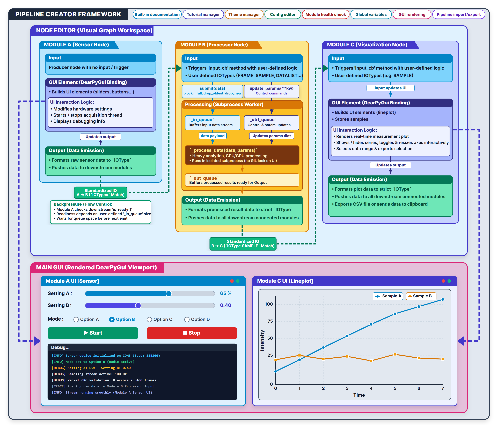
</p>

Pipeline Creator operates across four interconnected core layers:

1. **User Interface & Application Management:** Powered by [**DearPyGui**](https://github.com/hoffstadt/DearPyGui) with centralized window docking (*Fusion Manager*), customizable themes, display scaling, and a 3-tier privilege system (`User`, `Advanced`, `Dev`).
2. **Node Framework:** Visual wiring between typed inputs and outputs (`IOTypes`), conditional `Gate` routing tied to Views, dynamic module discovery, and non-destructive JSON pipeline merging/serialization.
3. **Data Communication:** Hybrid routing combining direct node-to-node data pipelines with a global **Link Bus** (Zero-Wire Routing) for decoupled messaging.
4. **Execution & Concurrency:** Main GUI thread isolation paired with background multiprocessing, transparent shared-memory IPC for large NumPy payloads, and live performance telemetry.

---

## Core Capabilities Showcase

### 1. Visual Node Editor, Type Safety & Flow Routing

Build pipelines graphically on an infinite, searchable canvas. Every wire is validated against standardized **`IOTypes`** (`FRAME`, `NUMBER`, `SAMPLE`, `CMD_DICT`, etc.) to prevent runtime mismatches, while **Link In / Link Out** nodes eliminate wire clutter via named channels and **Gate** nodes act as switchable valves controlled per View.

<p align="center">
  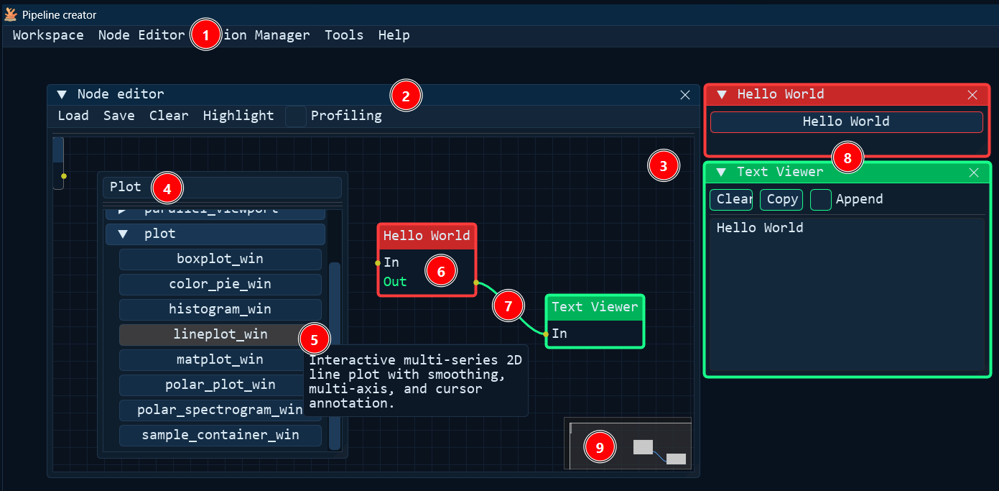
</p>

<table align="center">
  <tr>
    <td align="center" width="33%">
      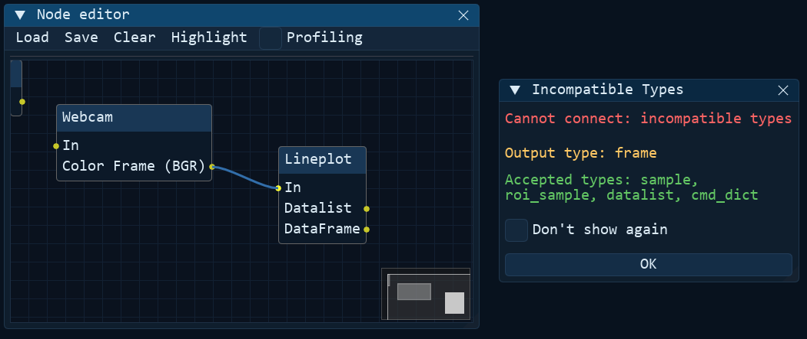<br>
      <sub><b>IOType Validation:</b> catches incompatible connections before runtime.</sub>
    </td>
    <td align="center" width="33%">
      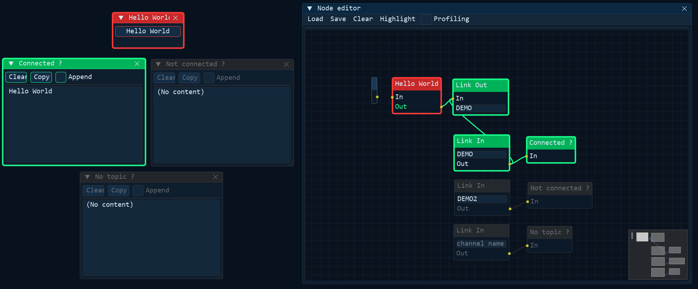<br>
      <sub><b>Link Bus (Zero-Wire):</b> broadcast streams by channel with virtual link previews.</sub>
    </td>
    <td align="center" width="33%">
      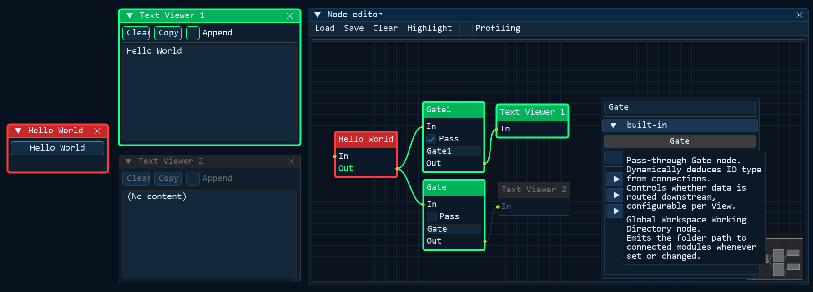<br>
      <sub><b>Gate Nodes & Views:</b> toggle active pipeline branches dynamically per View.</sub>
    </td>
  </tr>
</table>

> 📖 Details: [Node Editor Guide](https://n3odym3.github.io/Pipeline_creator/node_editor_guide/) · [IOType Reference](https://n3odym3.github.io/Pipeline_creator/developer_guide/#iotypes-reference)

---

### 2. Workspace Docking, No-Code UI Editing & Access Control

Turn a multi-window pipeline into a clean operator console without writing UI boilerplate:

<table align="center">
  <tr>
    <td align="center" width="50%">
      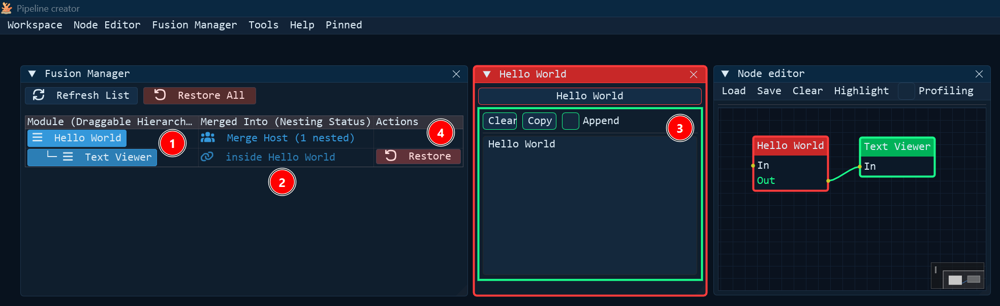<br>
      <sub><b>Fusion Manager:</b> drag-and-drop docking (including nested tabs) to group floating module windows.</sub>
    </td>
    <td align="center" width="50%">
      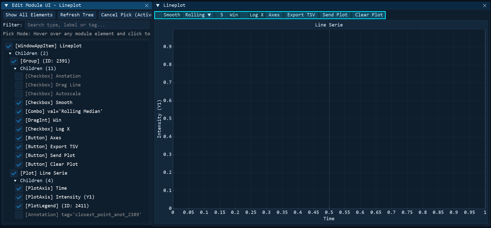<br>
      <sub><b>Module Item Inspector (Edit Module):</b> pick and hide individual widgets per View or pipeline.</sub>
    </td>
  </tr>
  <tr>
    <td align="center" width="50%">
      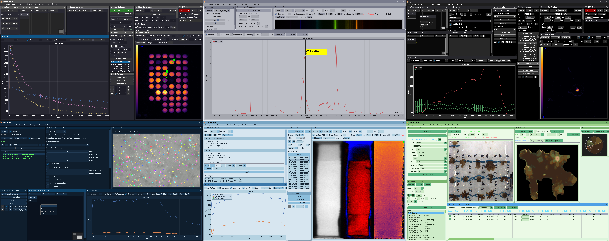<br>
      <sub><b>Themes & Colorblind Modes:</b> customizable color palettes and colorblind-safe node coloring.</sub>
    </td>
    <td align="center" width="50%">
      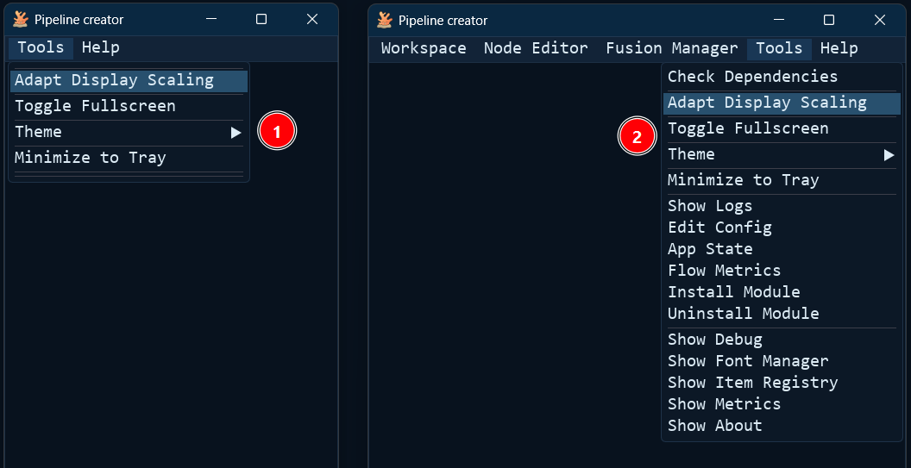<br>
      <sub><b>Role-Based Privileges:</b> switch between locked-down <code>User</code>, <code>Advanced</code>, and <code>Dev</code> modes.</sub>
    </td>
  </tr>
</table>

> 📖 Details: [Main Window Guide](https://n3odym3.github.io/Pipeline_creator/main_window/) · [Fusion Manager Guide](https://n3odym3.github.io/Pipeline_creator/fusion_manager/)

---

### 3. Live Profiling, Flow Metrics & Benchmarking

Inspect bottlenecks and validate throughput under load without slowing down the UI:

- **In-Canvas Profiling & Heartbeat:** Visualize active data streams directly on nodes and wires, and open per-node telemetry reports (mean/P95 latency, rates, memory).
- **Inline Propagation Tester:** Drop a speedometer node between any two points to measure exact transit latency ($\Delta t$).
- **Flow Metrics Viewer & Benchmark Suite:** Monitor app-wide FPS, CPU%, RAM, queue fill levels, and downstream backpressure (`HOLD`), or stress-test nodes with 7 synthetic generators/sinks in `modules/Benchmark/`.

<table align="center">
  <tr>
    <td align="center" width="50%">
      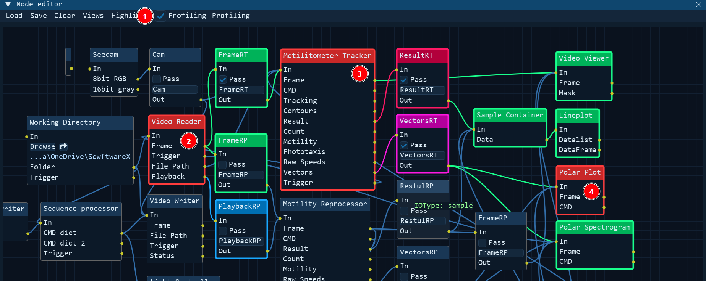<br>
      <sub><b>In-Canvas Profiling:</b> live stream heartbeat and congestion highlighting.</sub>
    </td>
    <td align="center" width="50%">
      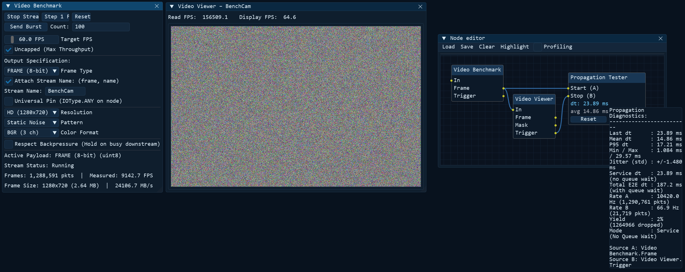<br>
      <sub><b>Propagation Tester:</b> non-intrusive inline Δt latency speedometer.</sub>
    </td>
  </tr>
</table>

<p align="center">
  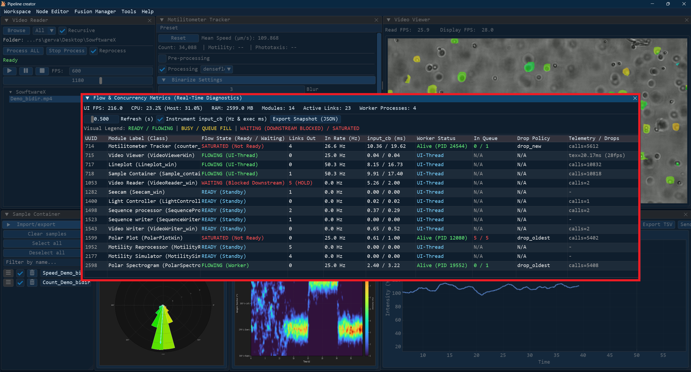<br>
  <sub><b>Flow Metrics Viewer:</b> centralized process, queue occupancy, and drop-policy diagnostics (with JSON snapshot export).</sub>
</p>

> 📖 Details: [Timing, Benchmarks & Queue Safety](docs/timing_benchmarks_and_safety.md)

---

### 4. Interactive Tutorials, Module Management & Diagnostics

<table align="center">
  <tr>
    <td align="center" width="50%">
      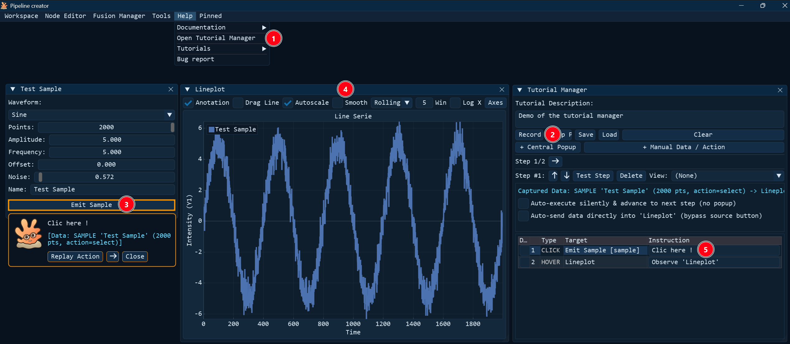<br>
      <sub><b>Tutorial Manager & Data Replay:</b> record UI guides with screen dimming, prerequisite checks, per-module <code>tutorial.json</code> files, and raw data-stream capture/replay across all <code>IOTypes</code> for hardware-free demos.</sub>
    </td>
    <td align="center" width="50%">
      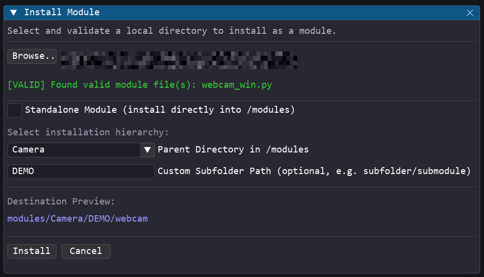<br>
      <sub><b>Module Manager & Diagnostics:</b> GUI install/uninstall with cached AST & dependency health checks, real-time <code>Log Viewer</code>, startup automation scripts, and automatic crash detection with a built-in <code>Bug Report</code> tool.</sub>
    </td>
  </tr>
</table>

> 📖 Details: [Tutorial Manager](https://n3odym3.github.io/Pipeline_creator/tutorial_manager/) · [Module Manager](https://n3odym3.github.io/Pipeline_creator/module_manager/) · [Automation & Login](https://n3odym3.github.io/Pipeline_creator/automation_login/)

---

## Real-World Scientific Examples

<details open>
<summary><b>1. Automated Spectroscopy & Live Peak Deconvolution</b></summary>

<br>

<p align="center">
  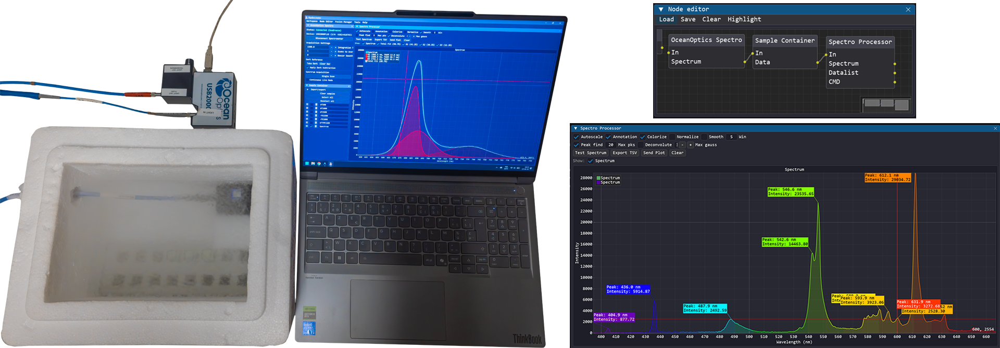
</p>

* **Hardware:** Ocean Optics USB2000+ Spectrometer & 450 nm LED source.
* **Pipeline:** Interconnected spectrometer driver, sample container, and live spectral processor.
* **Application:** Real-time 77 K microalgae fluorescence deconvolution. The processor continuously separates overlapping emission bands to isolate individual Photosystem I (PSI) and Photosystem II (PSII) contributions directly inside the live acquisition loop.

</details>

---

<details open>
<summary><b>2. Multi-Instrument Oxygen Exchange & Respiration Monitor</b></summary>

<br>

<p align="center">
  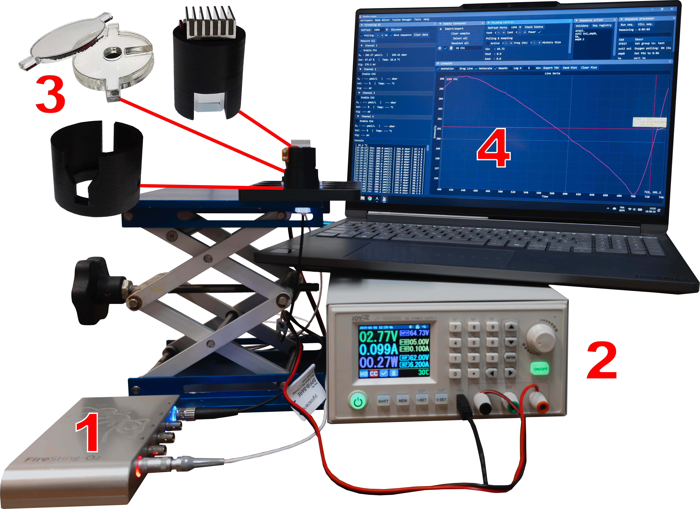
</p>

* **Hardware:** FireSting-O2 optical meter (OXSP5 sensor spot), Joy-It programmable LED power supply, custom 3D-printed cuvette.
* **Pipeline:** Multi-device synchronization with automated scripting orchestrating illumination cycles.
* **Application:** Time-aligned monitoring of *Chlamydomonas reinhardtii* photosynthetic oxygen evolution and dark respiration, fully controlled via human-readable automated scripts.

</details>

---

<details open>
<summary><b>3. Field Coral Thermal Resilience Imaging (Tara Expedition)</b></summary>

<br>

<p align="center">
  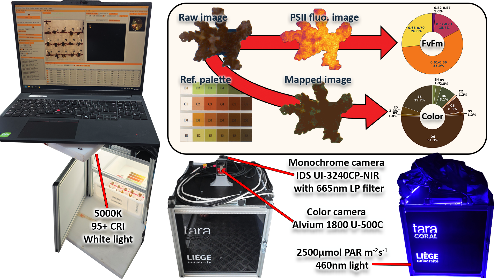
</p>

* **Hardware:** Dual-modal system combining high-resolution colorimetry (5000K LED) and NIR chlorophyll fluorescence (460 nm pulse driver).
* **Pipeline:** On-site AI segmentation using the Segment Anything Model (SAM) for color analysis and fast contour tracking for $F_v/F_m$ extraction.
* **Application:** Deployed aboard the *Tara* schooner for standardized CBASS bleaching assays, leveraging role-based permissions and tutorials for rapid rotation among international science crews.

</details>

---

<details open>
<summary><b>4. Microalgal Motility & Cell Tracking Dashboard</b></summary>

<br>

<p align="center">
  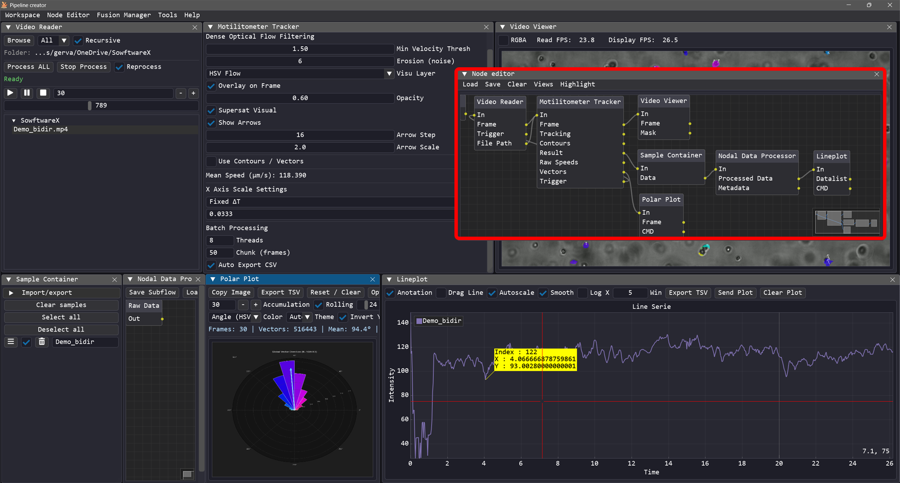
</p>

* **Modernization:** Replaces a legacy command-line tool with a fully interactive graphical dashboard.
* **Pipeline:** Real-time video playback and dynamic parameter tuning for tracking algorithms.
* **Application:** Live extraction of swimming speeds (line plots), vector distributions (histograms), and phototactic swimming directionality (polar plots).

</details>

---

## Quick Start

### Installation

```bash
# Clone the repository
git clone https://github.com/n3odym3/Pipeline_creator.git
cd Pipeline_creator

# Install dependencies
pip install -r requirements.txt
# Or:
pip install dearpygui loguru numpy pillow
```

### Launching the Application

```bash
python main.py

# Or start directly with an automation script:
python main.py --script scripts/Demo.json
```

> [!TIP]
> You can also compile Pipeline Creator into a standalone executable (for machines without Python) using `make_executable.py` and Nuitka. See the [Compile Program Guide](https://n3odym3.github.io/Pipeline_creator/dev_compile/).

---

<a id="modules-repositories"></a>
## 📦 Modules Repositories

Pipeline Creator is built on an extensible architecture. Depending on your needs, you can plug in generic standalone modules or explore complete turnkey project implementations built on top of the framework:

### Standalone Module Repositories
*Generic, plug-and-play modules designed to be copied directly into the `modules/` directory (or installed via `Tools → Install Module`).*

| Name | Repository | Description |
| :--- | :--- | :--- |
| **Camera Modules** | [n3odym3/PC_Camera_modules](https://github.com/n3odym3/PC_Camera_modules) | A collection of generic camera acquisition and streaming modules supporting multiple camera types (webcams, USB video, IP cameras, industrial cameras) and virtual camera creation. |
| **Computer Vision Modules** | [n3odym3/PC_Computer_Vision_modules](https://github.com/n3odym3/PC_Computer_Vision_modules) | A collection of computer vision, image processing, segmentation, and algorithmic analysis modules (barcode and QR decoding, AI-assisted interactive segmentation with SAM, color classification, transparent image extraction, and flat-field optical vignetting correction). |
| **Images and Video Tools** | [n3odym3/PC_Images_and_video_tools](https://github.com/n3odym3/PC_Images_and_video_tools) | A collection of image and video visualization, processing, playback, and recording modules (in-memory image sequence containers, high-performance image and low-latency video viewers, video file readers, and synchronized multi-backend video writers). |
| **Plot Modules** | [n3odym3/PC_Plot_modules](https://github.com/n3odym3/PC_Plot_modules) | A collection of real-time graphing, data plotting, statistical distribution, and signal visualization modules (multi-channel line plots, boxplots, histograms, color pie charts, polar optical flow plots, and Matplotlib integration). |

### Complete Project Repositories
*Full implementations integrating Pipeline Creator with tailored modules, automated execution scripts, and specialized dashboard layouts.*

| Name | Repository | Description |
| :--- | :--- | :--- |
| **Pipeline Creator TARA** | [n3odym3/Pipeline_creator_TARA](https://github.com/n3odym3/Pipeline_creator_TARA) | Complete software implementation for the **Polymager** instrument, deployed during the [Tara Coral Expedition](https://fondationtaraocean.org/en/expedition/tara-coral/) for photosynthetic efficiency analysis ($F_v/F_m$) and coral bleaching assessment. |
| **Pipeline Creator Motilitometer** | [n3odym3/Pipeline_creator_Motilitometer](https://github.com/n3odym3/Pipeline_creator_Motilitometer) | Complete software implementation for the **Motilitometer**, dedicated to microalgal motility and cell tracking analysis with real-time extraction of swimming speeds, trajectory distributions, and phototactic directionality. |

---

## 📖 Documentation

For full guides, configuration references, and developer tutorials, explore the [Documentation Wiki](https://n3odym3.github.io/Pipeline_creator/) (or launch it locally from the app via **Help → Documentation → Start Server**):

- **User Guides:** [Main Window](https://n3odym3.github.io/Pipeline_creator/main_window/) · [Node Editor](https://n3odym3.github.io/Pipeline_creator/node_editor_guide/) · [Fusion Manager](https://n3odym3.github.io/Pipeline_creator/fusion_manager/) · [Tutorial Manager](https://n3odym3.github.io/Pipeline_creator/tutorial_manager/) · [Module Manager](https://n3odym3.github.io/Pipeline_creator/module_manager/) · [Timing & Benchmarks](docs/timing_benchmarks_and_safety.md) · [Automation & Login](https://n3odym3.github.io/Pipeline_creator/automation_login/)
- **Developer Guides:** [Architecture](https://n3odym3.github.io/Pipeline_creator/architecture/) · [Developer Guide](https://n3odym3.github.io/Pipeline_creator/developer_guide/) · [Creating a UI Node](https://n3odym3.github.io/Pipeline_creator/dev_ui_node/) · [Creating a Processor Node](https://n3odym3.github.io/Pipeline_creator/dev_processor_node/) · [Compile Program](https://n3odym3.github.io/Pipeline_creator/dev_compile/)

---

## 📄 License

This project is licensed under the [MIT License](LICENSE).
