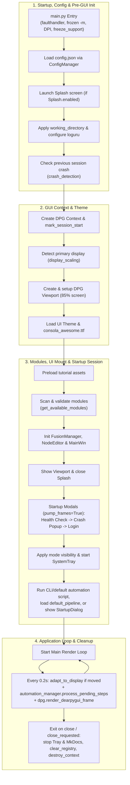
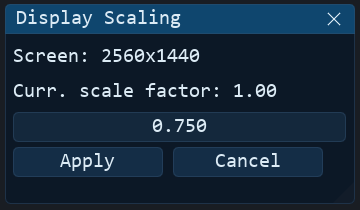
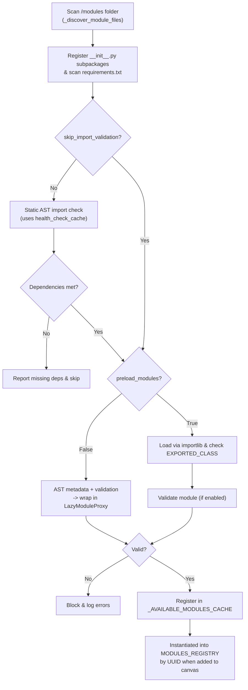

# <u>Architecture Overview</u>

This page describes the internal architecture of Pipeline Creator : how the application starts, manages state, handles scaling, and routes data between modules.

## <u>Boot Sequence</u>

The application lifecycle starts at `main.py` and proceeds through four distinct phases:



### Key Boot Stages

1. **Pre-GUI & Self-Execution Setup**: Before initializing DearPyGui, `main.py` enables `faulthandler` (`fault.log`), handles frozen/Nuitka self-execution (`-m mkdocs`, `-m pip`, `runpy`), sets Windows `SetProcessDpiAwareness(2)` and `multiprocessing.freeze_support()`, and loads `config/config.json` first so every subsequent stage can read configuration flags.
2. **Isolated Splash**: A `tkinter`-based splash screen runs in a **separate process** (`core/splash.py`) so it stays animated while configuration, logging, DearPyGui context setup, theme loading, and module scanning execute in the main process.
3. **Crash Tracking**: If `General.check_crash_on_boot` is enabled, `crash_detection.previous_session_crashed()` inspects `logs/app.log` *before* `mark_session_start()` writes the new session marker (once the DPG context exists for `log_viewer.sink`). If an abnormal exit is detected, the [crash recovery popup](main_window.md#bug-report-crash-recovery) is shown at boot. Normal shutdown logs `"Pipeline Creator closed successfully"`.
4. **Deferred Module Discovery**: `get_available_modules(force_reload=True)` runs *after* the DearPyGui context, viewport, and theme are ready, ensuring module metadata, validation, and optional preloading initialize cleanly.
5. **Frame Pumping for Startup Dialogs**: Blocking startup modals (`ModuleHealthManager`, crash recovery popup, `LoginDialog`, and `StartupDialog`) run before the main render loop using `pump_frames=True`, manually calling `automation_manager.process_pending_steps()` and `dpg.render_dearpygui_frame()` until dismissed.

---

## <u>App State (`app_state.py`)</u>

A global singleton that tracks the session context, accessible from any module. You can also define and add custom attributes to this singleton if your modules need to exchange global status or state flags between each other:

```python
from core.app_state import app_state

# Read the current mode
if app_state.mode == "dev":
    show_debug_panel()

# Check if login is complete
if app_state.login_done:
    enable_workspace_features()
```

| Attribute | Type | Description |
|---|---|---|
| `username` | `str` | The logged-in profile name |
| `mode` | `str` | Privilege mode: `"user"` \| `"advanced"` \| `"dev"` |
| `login_done` | `bool` | Blocks UI bypass before the login dialog completes |
| `close_requested` | `bool` | Set to `True` to trigger graceful shutdown |

---

## <u>Display Scaling (`display_scaling.py`)</u>

Pipeline Creator adapts layouts and font sizes dynamically when running on screens with different DPI ratings or when the window is moved to a different monitor.

### Percentage-Based Geometry

Window positions and sizes are saved as **screen percentages** rather than pixel values. This makes pipelines portable across different resolutions:

**pos_pct** = (**pos_px** / **viewport_size**) × 100.0

On load, percentages are re-multiplied by the current viewport size to recover pixel positions.

### Multi-Monitor Adaptation

In the main render loop, the viewport position is cached each frame. If the window moves to a different monitor:

1. `display_scaling.adapt_to_display()` detects the new monitor's native resolution.
2. A scale factor is computed relative to the 1080p baseline (e.g., `2.0` for 4K).
3. Fonts and window bounds are proportionally rescaled.

You can also trigger this manually via **Tools → Adapt Display Scaling**.



!!! note "Manual Scaling Adjustment"
    The scaling control slider allows you to apply a manual scaling multiplier on top of the automatic DPI calculation, enabling you to manually enlarge or shrink the final rendered UI layout.

## <u>Fonts (`merge_fonts.py`)</u>
By default, the program uses the **Consolas** font (`consola.ttf`) for text rendering. To enrich the graphical user interface, **FontAwesome** is also utilized to display icons. However, DearPyGui is unable to use multiple font files simultaneously on the same item; it can only switch between fonts.

To overcome this limitation, the script `/tools/merge_fonts.py` uses `fonttools` to merge the Unicode character mappings of both fonts, creating a hybrid font called `consola_awesome.ttf`. This custom unified font retains Consolas for text rendering while embedding FontAwesome's icon glyphs. This allows any module to display icons inline next to text by referencing standard FontAwesome Unicode characters (which can be found on [fontawesome.com](https://fontawesome.com/)).


## <u>Module Registry (`module_registry.py`)</u>

The registry manages two complementary maps:

- **Available Modules (`_AVAILABLE_MODULES_CACHE` via `get_available_modules()`)**: Discovered module classes (or `LazyModuleProxy` wrappers) located in `/modules`, exposed so the [Node Editor](node_editor_guide.md) can list and instantiate them.
- **Active Instances (`MODULES_REGISTRY`)**: Live module instances currently open in the workspace, indexed by `UUID`.

This discovery and validation pipeline runs automatically during startup (after DearPyGui initialization) and can reuse results from `.cache/health_check_cache.json` for unmodified files. Directories containing `__init__.py` are treated as local Python packages and registered with `LocalPackagesFinder`, while `requirements.txt` files are scanned by `dependency_manager`. To be exposed in the Node Editor, modules must pass dependency checks and adhere to the [Developer Best Practices](developer_guide.md#developer-best-practices).

### Discovery Pipeline



### Static Dependency Pre-Check & Lazy Loading

Before importing any module file, the registry performs an **AST (Abstract Syntax Tree)** scan (cached in `.cache/health_check_cache.json`) to extract `import` and `from ... import` statements and detect missing packages *before* attempting to execute the file. When `General.preload_modules` is `false`, modules are registered as `LazyModuleProxy` objects using statically extracted metadata (`EXPORTED_CLASS`, `EXPORTED_NAME`, docstring) and only imported on first instantiation.

### Key Registry Functions

| Function | Description |
|---|---|
| `get_available_modules()` | List all discovered module classes / `LazyModuleProxy` entries |
| `get_registered_modules()` | List all active module *instances* from `MODULES_REGISTRY` |
| `scan_modules_health()` | Run a full dependency and AST validation scan (with cache support) |
| `load_workspace(path)` | Deserialize and reconstruct a flow JSON file |
| `export_workspace(path)` | Serialize the current graph to a flow JSON file |
| `apply_view(mode)` | Apply the saved window layout for a privilege mode |

---

## <u>Module Health Check (`module_health_manager.py`)</u>

During startup discovery (unless `General.skip_import_validation` is `true` or an automation script is running) and on manual triggers via **Tools → Check Dependencies**, `ModuleHealthManager` coordinates dependency and static code checks across all discovered modules. If issues are found (or when run manually), it displays a tabbed **Module Health Check** dialog (`pump_frames=True` at boot).

Issues determine whether a module is loaded or excluded from the available modules registry:

### Missing Dependencies Tab

If a module references Python libraries or `requirements.txt` packages that are not installed on the system, the registry blocks the module from loading to prevent runtime `ImportError` crashes.
* **Auto-Recovery**: Lists missing packages with an **Install** button per package and an **Install All** button triggering `pip install`.
* **Requirement**: Once installation completes, restart the application to reload the new packages.

### Validation Tab

Displays violations of the [Developer Best Practices](developer_guide.md#developer-best-practices) discovered during static code analysis:

* **ValidationLevel.WARNING**: Minor issue; the module is marked with a warning and remains **usable** in the Node Editor.
* **ValidationLevel.ERROR**: Critical violation (e.g., duplicate DearPyGui tags without `self.UUID`); the module is **excluded** from loading until corrected.

### DPG Callbacks Tab

When Nuitka/compiled-mode callback signature issues are detected (callbacks missing `*args` / `*args, **kwargs`), this tab lists each affected method and provides one-click **Auto-fix** buttons (per module or for all modules).

*(Manual scans with no errors or warnings show an **All Healthy** tab, along with **Rescan (Cached)** and **Force Full Rescan (Clear Cache)** actions.)*

---

## <u>Node Editor Graph System (`node_editor.py`)</u>

Once modules are discovered and validated, they can be instantiated inside the Node Editor visual graph. The Node Editor provides a zoomable, pannable graphical canvas built on top of DearPyGui where users organize and interconnect module nodes. It coordinates:

- **Connection Type Validation**: Wires drawn between terminals are automatically validated against `IOTypes` to ensure data compatibility.
- **Workspace Persistence**: The entire visual state, module parameters, node coordinates, and connection paths are serialized to JSON.
- **Interaction Handlers**: Double-clicking a node brings its GUI window to the foreground, while right-clicking opens actions such as edit, rename, delete, and tutorials.

The visual graph is managed by [`NodeEditor`](node_editor_guide.md), which inherits from five mixins:

```mermaid
graph BT
    NodeHighlightMixin["NodeHighlightMixin\nVisual theme coloring"] --> NodeEditor
    NodePerfProfilerMixin["NodePerfProfilerMixin\nLive flow & latency profiling"] --> NodeEditor
    NodePopupMixin["NodePopupMixin\nFuzzy search popup"] --> NodeEditor
    NodeCallbacksMixin["NodeCallbacksMixin\nDPG mouse & link events"] --> NodeEditor
    NodeSerializationMixin["NodeSerializationMixin\nSave & load workspaces"] --> NodeEditor
    classDef mixin fill:#1a4d4d,stroke:#33b2b2,stroke-width:2px;
    class NodeHighlightMixin,NodePerfProfilerMixin,NodePopupMixin,NodeCallbacksMixin,NodeSerializationMixin mixin;
```



* **NodeHighlightMixin**: Governs highlighting downstream nodes, dimming unconnected modules, drawing dashed *virtual links* between wireless Link channels, and respecting Gate pass-through states during downstream traversal.
* **NodePerfProfilerMixin**: Manages in-canvas live flow profiling, pulsing active wires/nodes, saturation indicators, and per-node telemetry popups/reports.
* **NodePopupMixin**: Builds the right-click module selection menu and manages the fuzzy search list (including built-in `Link In`, `Link Out`, `Gate`, `Working Directory`, and `Propagation Tester` nodes).
* **NodeCallbacksMixin**: Processes link creation, link deletion, double-clicks, single-input constraints for Gate nodes, dynamic IOType deduction, and warning modals for incompatible connections.
* **NodeSerializationMixin**: Exports active configurations and built-in nodes (`Link In`, `Link Out`, `Gate`, `Working Directory`, `Propagation Tester`) to file and handles regenerating the graph and rewiring connections upon launch.
