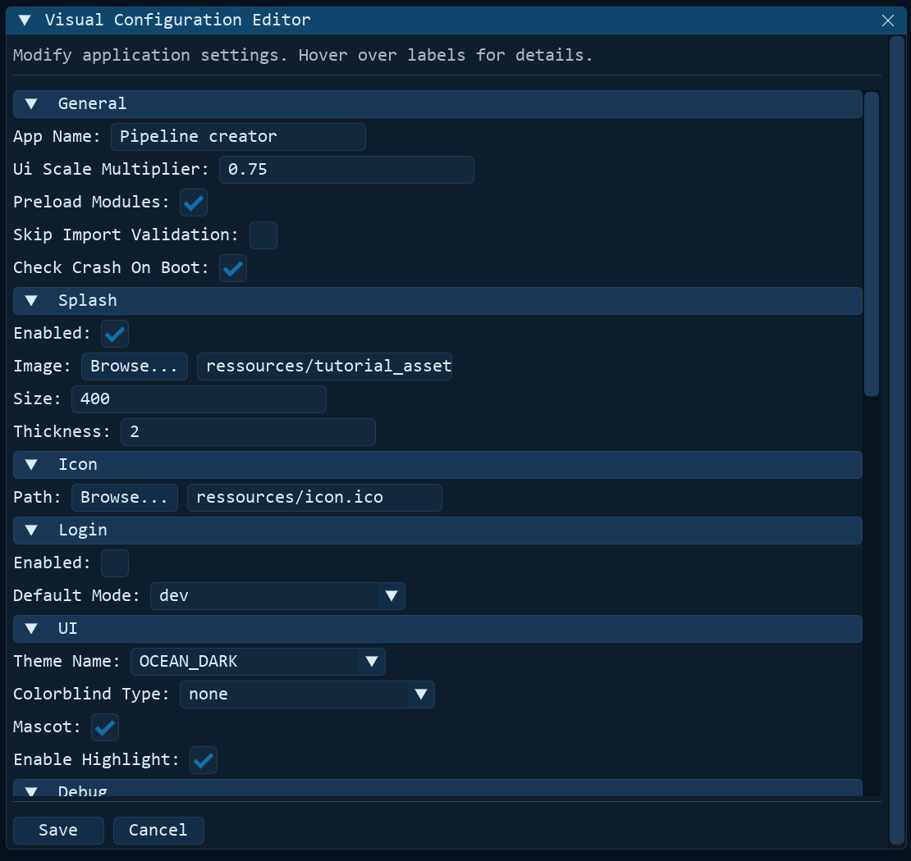

# <u>Configuration Reference</u>

All application settings are stored in `config/config.json`. This file is loaded at startup, can be edited manually, or modified visually via the built-in configuration editor (**Tools → Edit Config**).


## <u>Full Schema</u>

```json
{
    "General": {
        "app_name": "Pipeline creator",
        "ui_scale_multiplier": 0.75,
        "preload_modules": true,
        "skip_import_validation": false,
        "check_crash_on_boot": true
    },
    "Splash": {
        "enabled": true,
        "image": "ressources/tutorial_assets/tutorial/Tutorial3.png",
        "size": 400,
        "thickness": 2
    },
    "Icon": {
        "path": "ressources/icon.ico"
    },
    "Login": {
        "enabled": false,
        "default_mode": "dev"
    },
    "UI": {
        "theme_name": "DEFAULT",
        "colorblind_type": "none",
        "mascot": true,
        "enable_highlight": true
    },
    "Debug": {
        "enabled": true,
        "log_level": "TRACE",
        "log_mkdocs": false
    },
    "Window": {
        "vsync": true,
        "minimize_to_tray": false,
        "tray_offscreen": true,
        "show_console": true
    },
    "Paths": {
        "working_directory": "experiments",
        "default_pipeline": null,
        "default_automation_script": "",
        "show_loader_on_startup": true,
        "default_pipeline_folder": "pipelines",
        "default_scripts_folder": "scripts"
    },
    "Cameras": {
        "IDS": {
            "rotation": 90
        },
        "Alvium": {
            "rotation": 90
        }
    },
    "Viewers": {
        "image_viewer": {
            "texture_mode": "raw",
            "preserve_aspect_ratio": false
        },
        "video_viewer": {
            "texture_mode": "static",
            "preserve_aspect_ratio": false
        }
    },
    "SequenceProcessor": {
        "end_seq_cmd": "R0G0B0W0IR1000"
    }
}
```

---

## <u>Section Reference</u>

### General

| Key | Type | Default | Description |
|---|---|---|---|
| `app_name` | `str` | `"Pipeline creator"` | Title displayed in the OS viewport title bar. |
| `ui_scale_multiplier` | `float` | `0.75` | Global scale multiplier applied on top of DPI auto-scaling. Adjust to enlarge or shrink UI elements across displays. |
| `preload_modules` | `bool` | `true` | If `true`, preloads and caches all module classes at startup (instant instantiation, slightly longer initial startup). If `false`, modules load on first instantiation. |
| `skip_import_validation` | `bool` | `false` | If `true`, skips startup module import health checks for faster boot. Manual health checks from **Tools → Check Dependencies** remain available. |
| `check_crash_on_boot` | `bool` | `true` | If `true`, checks `logs/app.log` at startup for an unclosed previous session and offers a crash report popup if detected. |

### Splash

Controls the animated splash screen shown while the application initializes.

| Key | Type | Default | Description |
|---|---|---|---|
| `enabled` | `bool` | `true` | Show or hide the splash screen on startup. |
| `image` | `str` | `"ressources/tutorial_assets/tutorial/Tutorial3.png"` | Relative path to the splash image file. |
| `size` | `int` | `400` | Width and height of the splash window in pixels. |
| `thickness` | `int` | `2` | Border thickness of the animated splash progress ring. |

### Icon

| Key | Type | Default | Description |
|---|---|---|---|
| `path` | `str` | `"ressources/icon.ico"` | Relative path to the application window icon (`.ico`). |

### Login

Controls the login and profile selection prompt at startup.

| Key | Type | Default | Description |
|---|---|---|---|
| `enabled` | `bool` | `false` | If `true`, requests profile selection before opening the main window. |
| `default_mode` | `str` | `"dev"` | Pre-selected privilege mode: `"user"`, `"advanced"`, or `"dev"`. |

!!! tip "Deploying to operators"
    Set `enabled: true` and `default_mode: "user"` when deploying machines to operators. Non-developer accounts only see simplified, operator-safe controls.

### UI

| Key | Type | Default | Description |
|---|---|---|---|
| `theme_name` | `str` | `"DEFAULT"` | Name of the active color palette (must match a dictionary in `config/theme_colors.py`). |
| `colorblind_type` | `str` | `"none"` | Colorblind correction palette: `"none"`, `"universal"`, `"protanopia"`, `"deuteranopia"`, `"tritanopia"`. |
| `mascot` | `bool` | `true` | Toggle display of the assistant mascot graphic in the main viewport. |
| `enable_highlight` | `bool` | `true` | Default activation state for downstream connection wire highlighting in the Node Editor. |

### Debug

| Key | Type | Default | Description |
|---|---|---|---|
| `enabled` | `bool` | `true` | Enable global debug flags and extended logging. |
| `log_level` | `str` | `"TRACE"` | Minimum log severity level (`"TRACE"`, `"DEBUG"`, `"INFO"`, `"WARNING"`, `"ERROR"`, `"CRITICAL"`). |
| `log_mkdocs` | `bool` | `false` | Redirect stdout/stderr from the embedded MkDocs server subprocess into the main log stream. |

### Window

| Key | Type | Default | Description |
|---|---|---|---|
| `vsync` | `bool` | `true` | Enable vertical sync in the DearPyGui rendering loop to prevent tearing. |
| `minimize_to_tray` | `bool` | `false` | Minimize the application to the system tray instead of the OS taskbar. |
| `tray_offscreen` | `bool` | `true` | Move the window offscreen before minimizing to tray to eliminate visual flickering. |
| `show_console` | `bool` | `true` | Show or hide the background terminal console on Windows. |

### Paths

| Key | Type | Default | Description |
|---|---|---|---|
| `working_directory` | `str` | `"experiments"` | Default root folder for loading and saving data, pipelines, and export files. |
| `default_pipeline` | `str \| null` | `null` | Path to a pipeline JSON file to load automatically on application launch. |
| `default_automation_script` | `str \| null` | `""` | Path to an automation JSON script to execute automatically on launch. |
| `show_loader_on_startup` | `bool` | `true` | Show an interactive dialog at startup to choose a pipeline or script if none is specified. |
| `default_pipeline_folder` | `str` | `"pipelines"` | Default directory for saving and browsing pipeline flow files. |
| `default_scripts_folder` | `str` | `"scripts"` | Default directory for saving and browsing automation scripts. |

### Cameras

Module-specific hardware configuration for industrial cameras:

| Key | Type | Default | Description |
|---|---|---|---|
| `IDS.rotation` | `int` | `90` | Video feed rotation angle in degrees (`0`, `90`, `180`, `270`) for IDS camera modules. |
| `Alvium.rotation` | `int` | `90` | Video feed rotation angle in degrees (`0`, `90`, `180`, `270`) for Allied Vision Alvium camera modules. |

### Viewers

Configuration for high-throughput image and video rendering modules:

| Key | Type | Default | Description |
|---|---|---|---|
| `image_viewer.texture_mode` | `str` | `"raw"` | Texture upload mode: `"raw"` (direct GPU streaming for high-FPS feeds) or `"static"` (zero PCIe transfer when idle). |
| `image_viewer.preserve_aspect_ratio` | `bool` | `false` | Preserve image aspect ratio (`true`) or stretch pixels to fill the viewport (`false`). |
| `video_viewer.texture_mode` | `str` | `"static"` | Texture upload mode for video playback: `"raw"` or `"static"`. |
| `video_viewer.preserve_aspect_ratio` | `bool` | `false` | Preserve video aspect ratio (`true`) or stretch to canvas (`false`). |

### SequenceProcessor

Settings for automated sequence execution and optical triggers:

| Key | Type | Default | Description |
|---|---|---|---|
| `end_seq_cmd` | `str \| list` | `"R0G0B0W0IR1000"` | Command string or list of commands dispatched automatically to hardware upon sequence completion. |

---

## <u>Visual Configuration Editor</u>

All parameters in `config/config.json` can be inspected and edited through the **Visual Configuration Editor** (`core/config_editor.py`):

- Open **Tools → Edit Config** from the top menu bar (available in **Advanced** and **Dev** modes).
- The window builds collapsible sections and nested sub-trees directly from `config/config.json`. Hovering over any setting label displays its tooltip description.
- Clicking **Save** validates and casts each widget back to its original Python type (`bool`, `int`, `float`, `str`, or `None`), updates the in-memory `config` singleton immediately, and writes `config/config.json` to disk (some startup settings require an application restart to take effect).



### Configuration Description File (`config/config_anotation.json`)

The Visual Configuration Editor reads metadata from **`config/config_anotation.json`** to know how to describe and render each setting. Its JSON hierarchy mirrors `config/config.json`, where each leaf key contains two fields:

| Field | Type | Purpose |
|---|---|---|
| `description` | `str` | Tooltip text shown when hovering over the parameter label (defaults to `"No description available."` if omitted). |
| `values` | `null \| str \| list` | Controls which DearPyGui input widget is generated for the parameter. |

Supported `values` formats:

| `values` Entry | Rendered Widget | Behavior |
|---|---|---|
| `[true, false]` *(or `null` on a `bool`)* | **Checkbox** | Toggles boolean settings. |
| `["opt1", "opt2", ...]` | **Dropdown Combo** | Restricts selection to a predefined list of choices (strings or numbers). |
| `"file_browser"` | **Browse... + Text Input** | Opens a file picker; paths inside the project root are automatically stored as relative paths. |
| `"folder_browser"` | **Browse... + Text Input** | Opens a folder picker; paths inside the project root are automatically stored as relative paths. |
| `null` *(or key omitted)* | **Text Input** | Free-form text field, cast back to the key's original type (`int`, `float`, `str`, `None`) upon saving. |

```json
{
    "General": {
        "check_crash_on_boot": {
            "description": "If enabled, checks at startup whether the previous session ended abnormally.",
            "values": [true, false]
        }
    },
    "Paths": {
        "default_pipeline": {
            "description": "Path to the pipeline loaded by default on startup.",
            "values": "file_browser"
        },
        "working_directory": {
            "description": "Default root folder used to load and save pipelines and scripts.",
            "values": "folder_browser"
        }
    }
}
```

---

## <u>Accessing Config in Code</u>

Use the `config` singleton (`core.config_manager.config`) anywhere across the codebase:

```python
from core.config_manager import config

# Direct dictionary access
app_name = config.get("General", {}).get("app_name", "Pipeline Creator")

# Deeply nested helper access with fallback defaults
scale = config.get_nested("General", "ui_scale_multiplier", default=1.0)
rotation = config.get_nested("Cameras", "IDS", "rotation", default=0)

# Modify and persist changes programmatically
config["UI"]["theme_name"] = "OCEAN_DARK"
config.save()
```
