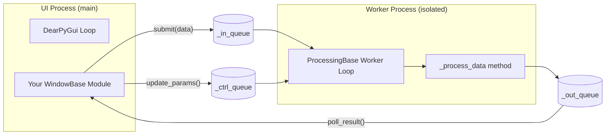

# Creating a Background Processor (`ProcessingBase`)

If your module performs CPU-intensive work (image processing, mathematical transforms, file scanning, serial communication loops), you must offload it to an isolated **background process** using `ProcessingBase`. This keeps the DPG render loop smooth and the UI frame rate stable.

---

## Why a Separate Process?

Python's **Global Interpreter Lock (GIL)** means that threads cannot truly run Python code in parallel. A heavy computation in a thread will still stall the UI thread.

`ProcessingBase` uses `multiprocessing`, which spawns a **separate OS process** with its own Python interpreter and memory space, completely bypassing the GIL.



---

## File Location

```
modules/<your_category>/<your_module_name>_proc.py
```

Convention: suffix the filename with `_proc` to indicate it is a background worker.

!!! note
    A processor is not a standalone module, it is meant to be **embedded inside a UI node** (`WindowBase` subclass) that manages the process lifecycle.

---

## Minimal Template

This template corresponds to `template_and_doc/processor_template.py`:

```python
from __future__ import annotations

import time
from typing import Any, Dict, Optional

from core.processing_base import ProcessingBase


class Processor_Template(ProcessingBase):
    """
    A template for building multiprocessing background worker processes.
    """

    # 1. Process Configuration (Class defaults - can also be overridden via kwargs)
    buffer_size = 10
    drop_policy = "drop_new"  # Options: 'drop_new', 'drop_oldest', or 'block'
    daemon = True

    def __init__(self, params: Optional[Dict[str, Any]] = None, **kwargs: Any) -> None:
        """
        Initialize the processor process.

        Args:
            params: Optional initial parameters dictionary passed to the worker.
            **kwargs: Extra configuration options forwarded to ProcessingBase.
        """
        super().__init__(params=params, **kwargs)

    def _process_data(self, data: Any, params: Dict[str, Any]) -> Any:
        """
        Actual data processing logic executed in the isolated worker process.

        WARNING: This method runs in a different process.
        - Do NOT access DPG (dpg.*) from here.
        - Do NOT modify shared module state directly.
        - Only communicate via the return value (sent to out_queue).

        Args:
            data: The incoming data packet from the submission queue.
            params: Dictionary containing current parameters/configuration.

        Returns:
            The processed result to be pushed to the out_queue.
        """
        # Simulated workload
        time.sleep(1.0)

        # Example processing using data and params:
        factor = params.get("multiplier", 1)
        if isinstance(data, (int, float)):
            return data * factor

        return True
```

---

## `ProcessingBase` Contract

### Starting and Stopping

```python
processor = Processor_Template(params={"multiplier": 2.0})
processor.start()    # Launch the background process
# ... later ...
processor.stop()     # Terminate gracefully
```

### Submitting Data

```python
success = processor.submit(my_data)
```

`submit()` attempts to enqueue data for processing and returns `True` if accepted, or `False` if dropped/rejected. Behavior on saturation depends on the `drop_policy`:

| Policy | Behavior | Implementation Details |
|---|---|---|
| `"drop_new"` *(default)* | Discard newly arriving item | Fast producer-side check; leaves existing queue intact. |
| `"drop_oldest"` | Discard oldest item ("latest wins") | Managed on the **worker side** via a dedicated receiver thread. The main process never unpickles discarded frames. |
| `"block"` | Block until space is available | Blocks the calling thread until an input slot is free. |

You can dynamically change the drop policy at runtime without restarting the process:
```python
processor.set_drop_policy("drop_oldest")
```

### Transparent Shared-Memory Transport

When working with heavy numerical payloads (such as large NumPy images, depth maps, or raw matrices), `ProcessingBase` automatically passes them through reusable **shared memory pools** (`ShmPool` via `core/shm_transport.py`) instead of serializing them through standard IPC pipes.

- **Zero-Copy**: Massive arrays bypass Python `pickle`, avoiding GC pressure and frame copy delays.
- **Transparent**: Subclasses send and return ordinary NumPy arrays without special encoding code.
- **Tunables (Class Attributes)**:
  - `use_shared_memory: bool = True`
  - `shm_threshold_bytes: int = 64 * 1024` (Arrays smaller than 64 KB use the fast pickle path)
  - `shm_max_pool_bytes: int = 512 * 1024 * 1024` (Cap per direction before fallback)

### Polling Results

```python
result = processor.poll_result(timeout=None)
```

- When `timeout=None` or `<= 0`: Non-blocking call returning immediately (`None` if queue is empty).
- When `timeout > 0`: Blocks up to `timeout` seconds, releasing the Python GIL to avoid busy-wait spinlocks.
- `processor.get()` and `processor.get_results()` are aliases of `poll_result()`.

### Diagnostics & Monitoring

`ProcessingBase` provides built-in metrics used by the system profiler and Flow Metrics Viewer:

- `processor.is_ready() -> bool`: Returns `True` if the worker is alive and queues are not full.
- `processor.has_data() -> bool`: Returns `True` if a processed result is waiting in the output queue.
- `processor.queue_size() -> int`: Returns the total number of pending items across IPC queue and worker buffer.
- `processor.drop_count() -> int`: Total number of frames discarded by the worker under `drop_oldest`.
- `processor.clear()`: Safely drains and releases all pending items in queues.

### Updating Parameters

```python
processor.update_params({"multiplier": 3.5})
```

Parameters are sent to the worker via `_ctrl_queue`. The worker applies them before the next `_process_data` call without restarting the process.

---

## Integrating a Processor into a UI Node

The recommended pattern is a **Hybrid module**: a `WindowBase` subclass that owns and manages a `ProcessingBase` worker.

```python
from __future__ import annotations
from typing import Any, Dict, Tuple, Optional
import dearpygui.dearpygui as dpg
from core.window_base import WindowBase
from core.input_output_types import IOTypes
from modules.processing.my_processor_proc import MyProcessor


class MyHybridNode(WindowBase):
    """
    A UI node with an embedded background processor.
    """

    def __init__(self, label="My Processor Node", ..., multiplier: float = 1.0) -> None:
        super().__init__(label=label, ...)

        self.persistent_fields = ["label", "multiplier"]
        self.accepted_input_types = [IOTypes.NUMBER]
        self.outputs = {"OUTPUT": IOTypes.NUMBER}
        self.connections = {k: [] for k in self.outputs}
        self.multiplier = multiplier

        # Create and start the background worker
        self._processor = MyProcessor(params={"multiplier": self.multiplier})
        self._processor.start()

        # ── DPG window using the self.window() context manager
        with self.window():
            dpg.add_text("Multiplier:")
            dpg.add_slider_float(
                tag=f"mult_slider_{self.UUID}",
                default_value=self.multiplier,
                min_value=0.1, max_value=10.0,
                callback=self._on_multiplier_changed,
            )

        # ── Register a DPG render callback to poll results each frame
        with dpg.item_handler_registry(tag=f"poll_handler_{self.UUID}"):
            dpg.add_item_visible_handler(callback=self._poll)
        dpg.bind_item_handler_registry(self.winID, f"poll_handler_{self.UUID}")

        self.update_permission()

    def _on_multiplier_changed(self, sender: Any, value: float) -> None:
        self.multiplier = value
        self._processor.update_params({"multiplier": value})

    def input_cb(self, *args: Any, **kwargs: Any) -> None:
        data = kwargs.get("data") or (args[0] if args else None)
        if data is not None:
            self._processor.submit(data)

    def _poll(self, *args: Any, **kwargs: Any) -> None:
        """Called each frame when the window is visible — polls for results."""
        result = self._processor.poll_result()
        if result and result.get("status") == "ok":
            from core.module_registry import MODULES_REGISTRY
            for uuid in self.connections.get("OUTPUT", []):
                target = MODULES_REGISTRY.get(uuid)
                if target:
                    target.input_cb(data=result["value"], data_type=IOTypes.NUMBER)

    def update_permission(self) -> None:
        from core.app_state import app_state
        is_user = (app_state.mode == "user")
        tag = f"mult_slider_{self.UUID}"
        if dpg.does_item_exist(tag):
            dpg.configure_item(tag, enabled=not is_user)

    def close(self) -> None:
        """Stop the background process on shutdown."""
        if hasattr(self, "_processor") and self._processor:
            self._processor.stop()
        super().close()


EXPORTED_CLASS = MyHybridNode
EXPORTED_NAME  = "My Processor Node"
```

---

## Important Constraints

!!! warning "No DPG access from the worker process"
    The `_process_data` method runs in a **separate process** — it has no access to DPG, the module registry, or any shared in-process state. All communication must go through the queues (submit / poll_result / update_params).

!!! warning "Serializable data only"
    Data passed through the queues must be **picklable** by Python's `multiprocessing` module. This includes: `int`, `float`, `str`, `list`, `dict`, `numpy.ndarray`. It excludes: DPG item IDs, open file handles, locks, and lambda functions.
