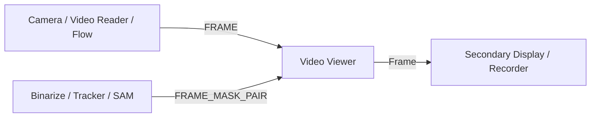

# Video Viewer Module

The **Video Viewer** (`VideoViewerWindow`) is a high-performance, low-latency video streaming display module for DearPyGui. It is designed to render camera streams, processed video feeds, and mask overlays at maximum frame rates without blocking the main UI thread.

---

## Technical Specifications

- **Accepted Inputs**:
  - `FRAME` (`IOTypes.FRAME`, `np.ndarray` or `(frame, source_name)` tuple): Grayscale, BGR, BGRA, or RGBA frames.
  - `MASK` (`IOTypes.MASK`, `np.ndarray`): Single-channel binary or probability mask.
  - `FRAME_MASK_PAIR` (`IOTypes.FRAME_MASK_PAIR`, tuple `(frame, mask)`): Base image paired with a mask overlay.
- **Outputs**:
  - `Frame` (`IOTypes.FRAME`): Pass-through output of current video frame.
  - `Mask` (`IOTypes.MASK`): Pass-through output of mask data if available.

---

## Paramètres et Configuration (Persistent Fields)

| Paramètre | Type | Valeur par défaut | Description |
| :--- | :--- | :--- | :--- |
| **`label`** | `str` | `"Video Viewer"` | Titre de la fenêtre du visualisateur vidéo. |
| **`fps_counter_enabled`** | `bool` | `True` | Active l'affichage en temps réel de la télémétrie FPS (*Read FPS* et *Display FPS*). |
| **`texture_mode`** | `str` | `"raw"` | Mode de texture GPU (`"raw"` pour accès mémoire direct haute vitesse, ou `"static"` en repli). |
| **`preserve_aspect_ratio`** | `bool` | `True` | Maintient le ratio d'aspect 1:1 pixel carré ou autorise l'étirement sur le canevas. |

---

## Key Features & Architecture

### 1. Non-Blocking Render Loop (600+ FPS)
- Ingestion and rendering are completely decoupled using a dedicated background worker thread and threading events.
- Employs a **"latest frame"** strategy: intermediate frames are automatically dropped if the rendering thread is busy, ensuring zero latency accumulation or buffer bloat.

### 2. Dual FPS Telemetry
- **Read FPS**: Measures the ingestion rate of incoming frames arriving from cameras, video files, or upstream processing nodes.
- **Display FPS**: Measures the actual rendering throughput achieved on the GPU canvas.
- Display values are smoothed over a 10-frame rolling window to prevent flickering.

### 3. Automatic Format & Transparency Handling
- Automatically detects and converts input color formats:
  - 1-channel Grayscale $\rightarrow$ RGBA.
  - 3-channel BGR $\rightarrow$ RGBA.
  - 4-channel BGRA/RGBA $\rightarrow$ normalized Float32 texture.
- Supports transparent background rendering (`_apply_transparency_theme`): non-selected mask regions or alpha=0 areas directly reveal the window background.

### 4. Display Scaling & Aspect Ratio Preservation
- Integrates `display_scaling.scale` for initial window bounds (`800x600` scaled) and toolbar spacing.
- Configurable aspect ratio behavior via `config.json` (`Viewers.video_viewer.preserve_aspect_ratio`):
  - `true` (default): Enforces `equal_aspects=True` on the canvas plot, ensuring 1:1 square pixel aspect ratio without distortion.
  - `false`: Sets `equal_aspects=False`, allowing the video frame to stretch and fit the entire canvas.

### 5. Raw vs Static GPU Textures
- Configurable via `config.json` (`Viewers.video_viewer.texture_mode`):
  - **Raw Mode** (`raw`): Direct memory buffer copy for maximum streaming throughput (default).
  - **Static Mode** (`static`): Fallback mode using DearPyGui static texture reconstruction.

---

## Pipeline Integration

