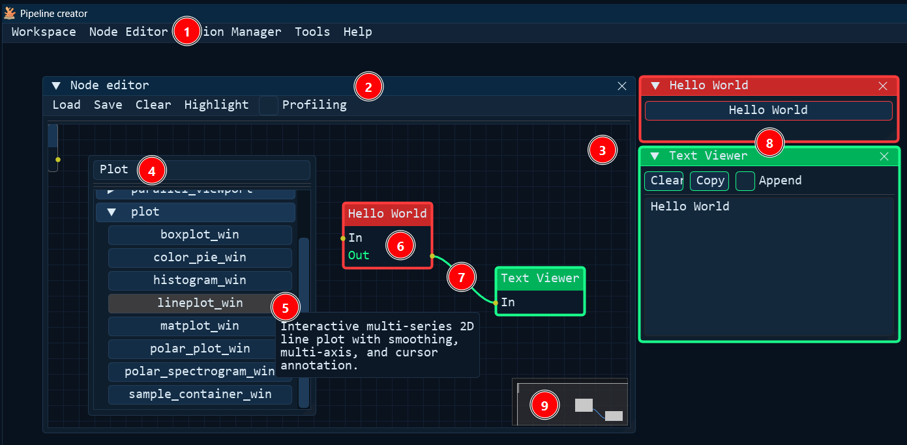
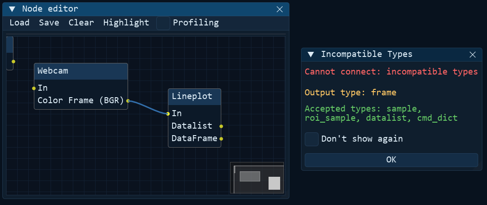
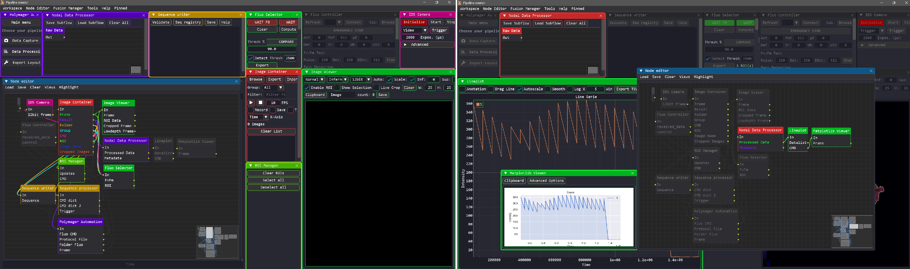
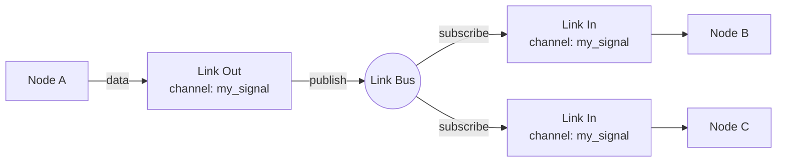
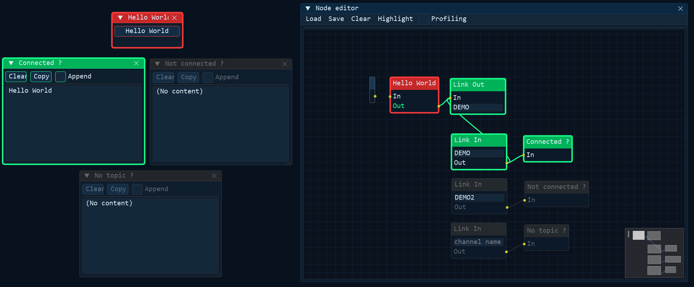
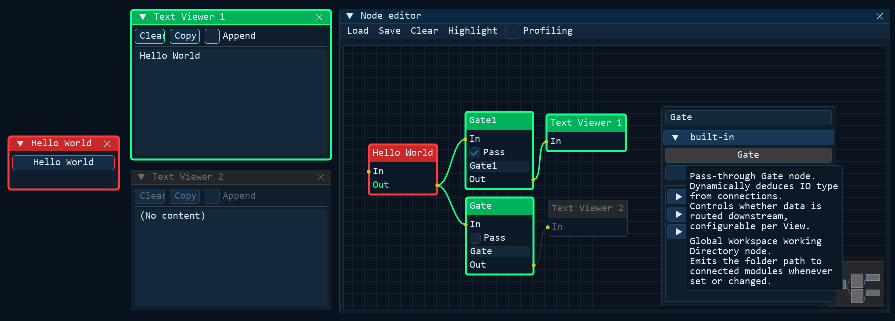
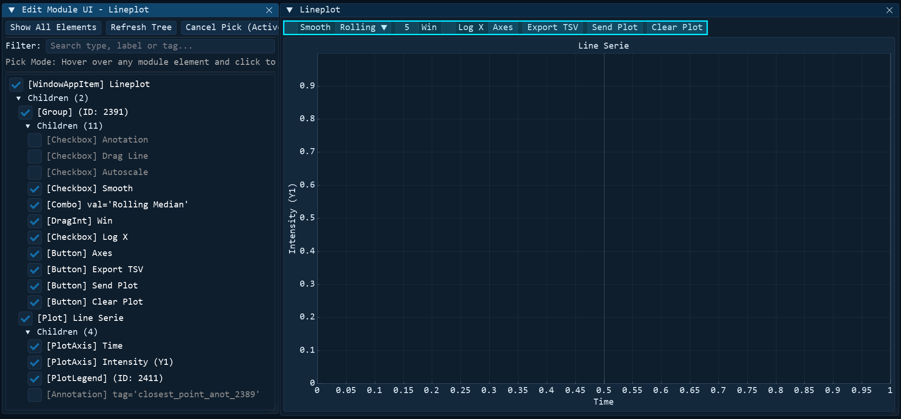
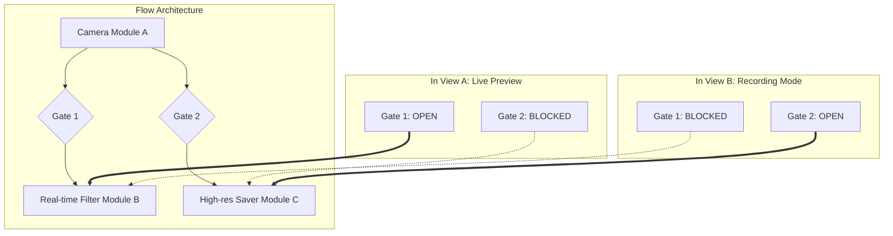

# <u>Node Editor Guide</u>

The **Node Editor** is the central workspace of Pipeline Creator. It is a visual canvas where you import, connect, and configure **node modules** to build custom pipelines. These pipelines can orchestrate control flows, process data, manage hardware interactions, or run visualization routines.

- **Module Connectivity**: Each module is equipped with a single input terminal and can have one or more output terminals.
- **Custom Logic**: Modules can contain arbitrary code and logic. They may include a graphical user interface (GUI) window, or run entirely in the background as invisible processing units.
- **Automated Data Transfer**: The link bus and wire routing system that handles data transfer between modules is completely automated by Pipeline Creator.
- **Interoperability & Future-Proofing**: To ensure modules remain compatible and interoperable, a standardized [Input/Output typing system](developer_guide.md#iotypes-reference) validates each connection.

---

## <u>Opening the Node Editor</u>



1. The editor can be launched from the **Main Window menu bar** via **Node Editor** (requires *Advanced* or *Dev* privilege mode).
2. The editor runs as a floating, resizable window within the viewport, allowing it to be moved, scaled, or docked.
3. An infinite, pannable, and zoomable workspace where node modules are instantiated, repositioned, and linked.
4. Right-clicking anywhere on the empty canvas opens the Module Search Popup. It allows you to search for specific modules and browse available categories (fuzzy matching supported).
5. Hovering over any module in the search list displays its custom documentation string as a tooltip.
6. Clicking a module from the search list instantiates the node, placing it on the canvas exactly at the current mouse pointer position.
7. Wires can be drawn between modules by clicking and dragging from an output terminal to an input terminal. Connections can be deleted/destroyed by holding `Ctrl` and clicking the wire (`Ctrl + Left Click`).
8. Once a module is instantiated, its corresponding control window appears. Double-clicking a module's node on the canvas brings its corresponding window to the foreground.
9. The minimap helps you navigate and orient yourself in large, complex flow graphs.

!!! note "Module Auto-Discovery & Validation"
    Modules are automatically detected, validated, and loaded at startup (see [Developer Best Practices](developer_guide.md#developer-best-practices)) from the `/modules` folder structure. Modules are grouped by **category** (their parent folder inside `/modules`)

| Action | How |
|---|---|
| **Pan** | Hold `Middle Mouse Button` and drag, or scroll while hovering |
| **Move node(s)** | Drag a selected node header |
| **Focus window** | Double-click a node to bring its corresponding module window to the foreground |
| **Context menu** | Right-click on a node to open actions: **Edit Module** (customize UI element visibility and layout), display module tutorial, rename the node, send to pinned modules, or delete the node/module. |

Every Input/Output has a declared **IOType** (e.g. `NUMBER`, `FRAME`, `TRIGGER`, `CMD_DICT`). When you attempt to connect incompatible types, the editor will show a **warning modal** explaining the mismatch. Compatible connections are accepted silently.



## <u>Highlighting & Dimming</u>

When you select a node, Pipeline Creator highlights its **downstream graph** to make the data flow visible.

The highlighting mode is configurable via **Node Editor → Highlight** menu:

| Mode | Effect |
|---|---|
| **Show All** | Highlights the complete downstream chain |
| **Closest** | Highlights only directly connected nodes |
| **None** | Disables highlighting |




Nodes that have *no* connections are **dimmed** to indicate they are inactive.

---

## <u>Built-in Nodes: Link In / Link Out</u>

These special nodes allow you to route data between modules without drawing a physical wire. Instead of a wire, they transmit data by matching **channel names**. This is especially useful when the output of a single module needs to feed into multiple other modules, preventing the visual workspace from being cluttered with dozens of crisscrossing wires.

Set the exact same **channel name** on a *Link Out* node and one or more *Link In* nodes to automatically link them.


Clicking on a **Link Out** node automatically draws and highlights temporary virtual links on the canvas, allowing you to easily trace the "wireless" connections to all subscribed **Link In** nodes.



!!! warning "No IOType Validation on Virtual Wires"
    Unlike standard node terminals, **Link In** and **Link Out** nodes do not perform compatibility checks on `IOTypes`. They use the generic `ANY` type, which theoretically allows connecting incompatible modules. 
    
    To avoid run-time errors, it is recommended to first prototype your flow using physical wires (which validates the data types), and then replace those wires with Link In/Out nodes to clean up the canvas.

---

## <u>Built-in Nodes: Gate (Conditional Flow Router)</u>

The **Gate** node acts as a switchable valve in your dataflow pipeline. It enables or stops data propagation along a branch without deleting or rewiring connections.



### Key Rules

- **Single Input, Multiple Outputs**: The `In` terminal accepts only 1 incoming connection to prevent collisions. The `Out` terminal supports multiple connections (fan-out).
- **Dynamic IOType**: The gate starts as `IOTypes.ANY` and automatically adapts to match connected wires. Hover over `In` or `Out` to see the current type.
- **Pass-Through Toggle**: Toggle the **Pass** checkbox directly on the node (or right-click → *Toggle Pass-through*). When enabled, data passes through; when disabled, data is dropped.
- **Canvas Highlighting**: In highlight mode, open gates let wire highlights pass through to downstream nodes. Closed gates block highlight propagation.

!!! note "Gate States in Views"
    Gate pass-through states (`ON` / `OFF`) are automatically preserved when exporting a View and restored upon loading. See [Views & Dynamic Flow Routing](#views-dynamic-flow-routing).
---

## <u>Edit Module UI (Module Item Inspector)</u>

The **Module Item Inspector** allows you to inspect, declutter, and customize the user interface of any module window by selectively hiding widgets (buttons, plots, inputs).

Open it by right-clicking any node on the canvas and selecting **Edit Module**.



### Key Features

- **Widget Hierarchy Tree**: Displays the full UI arborescence of the module. Toggle the checkbox next to any item to show or hide it.
- **Live Hover Highlighting**: Hovering over an item in the tree draws a bounding overlay around that widget on the live window.
- **Interactive Pick Mode**: Click **Pick Element**, hover over any widget on the module window, and click to automatically locate and highlight it in the tree.
- **Search & Reset**: Filter widgets by tag/label using the search bar, or click **Show All Elements** to restore full visibility.
- **View & Flow Persistence**: Hidden widget states (`hidden_items`) are automatically preserved when exporting Views or saving pipeline JSON files, and restored upon loading.

---

### <u>Node Editor Menu Bar</u>

| Menu | Item | Shortcut | Description |
|---|---|---|---|
| **Load** | Pipeline… | | Load a full workspace from a JSON file (replaces current canvas) |
| **Load** | Sub-pipeline… | | Append nodes and connections from a file without clearing current canvas |
| **Load** | Reload Last Sub-pipeline | | Quickly reload the last appended sub-pipeline file |
| **Load** | From Clipboard… | | Paste a serialized pipeline copied from the clipboard |
| **Save** | Edit / Update Pipeline… | | Surgically update node positions and connections in an existing JSON without altering views or metadata |
| **Save** | Pipeline to File… | | Export the entire workspace to a `.json` file |
| **Save** | Pipeline to Clipboard | | Copy the serialized workspace JSON to the clipboard |
| **Save** | Current View to Pipeline… | | Save current window positions and gate states into the pipeline |
| **Clear** | Delete Selected | `Del` | Delete selected nodes and links |
| **Clear** | Clear Selection | `Esc` | Deselect all currently selected nodes and links |
| **Clear** | Clear All Nodes | | Delete every node and link from the editor |
| **Views** | *(Saved Views)* | | Dynamically lists saved views to switch window layouts and Gate states in one click |
| **Highlight** | Show All / Closest / Selection / None | | Select downstream highlight propagation mode |
| **Profiling** | Profiling (Checkbox) | | Toggle real-time performance tracking (zero overhead when disabled) |
| **Profiling** | Show Heartbeat | | Pulse-color active nodes and links dynamically during live dataflow |
| **Profiling** | Pulse on Continuous Streams | | Animate heartbeat pulses on high-frequency streaming connections |
| **Profiling** | Show Virtual Links | | Display activity across virtual `Link Out` → `Link In` channels |
| **Profiling** | Heartbeat Hold Duration | | Set pulse duration (`Fast 150ms`, `Normal 240ms`, `Slow 450ms`) |
| **Profiling** | Reset All Node Metrics | | Reset all accumulated execution timestamps and statistics |
| **Profiling** | Close All Reports | | Close all open floating node performance telemetry report windows |

### <u>Flow File Format</u>

Workspaces are stored as human-readable JSON:

```json
{
    "is_relative": true,
    "windows": [
        {
            "uuid": "41680190-3cb8-4a57-b08f-287df5d1bf2b",
            "module": "modules.basic_ui.csv_reader_win",
            "pos": [15.2, 20.4],
            "size": [30.5, 40.0],
            "visible": true,
            "params": {
                "default_path": "data/samples.csv"
            }
        }
    ],
    "connections": [
        {
            "from": "41680190-3cb8-4a57-b08f-287df5d1bf2b",
            "output": "CSV_DATA",
            "to": "50c3d9a4-2e91-4c17-910a-3cb7217fd8b2"
        }
    ],
    "link_nodes": [
        {
            "kind": "gate",
            "uuid": "7a8b9c0d-1234-5678-9abc-def012345678",
            "label": "Gate_Branch_B",
            "is_open": true,
            "io_type": "FRAME",
            "node_pos": [250, 180],
            "connections": {
                "Out": ["target-module-uuid"]
            },
            "incoming": {
                "source_uuid": "source-module-uuid",
                "output_key": "Frame"
            }
        }
    ]
}
```

| Field | Description |
|---|---|
| `is_relative` | If `true`, `pos`/`size` are screen percentages (portable across resolutions) |
| `uuid` | Unique identifier for the node instance |
| `module` | Python import path of the module class |
| `params` | Saved values from the module's `persistent_fields` list |
| `connections` | Wires between output terminals and destination nodes |
| `link_nodes` | Built-in proxy nodes (`Link In`, `Link Out`, `Gate`, `Working Directory`, and `Propagation Tester`) |

---

## <u>Views & Dynamic Flow Routing</u> {: #views-dynamic-flow-routing }

**Views** are named presets that save both **window layouts** (position, size, visibility of each module window) and **Gate pass-through states** (`is_open`).

### Dynamic Flow Routing via Views

Because Views store Gate states, you can dynamically alter the active routing of your pipeline simply by switching Views!



- **Export View**: Save current window layout and live Gate states into a named preset via `Main Window → Workspace → Export View...` or from the **Pipeline Editor**.
- **Apply View**: Switching views via the **Views** menu or programmatically via `apply_named_view("ViewName")` applies window positioning and toggles all Gates to their saved state.
- **Pipeline Editor**: Under the **Views** tab, expand the **Gates in this View** section to individually toggle which gates are pass-through for the selected view.


