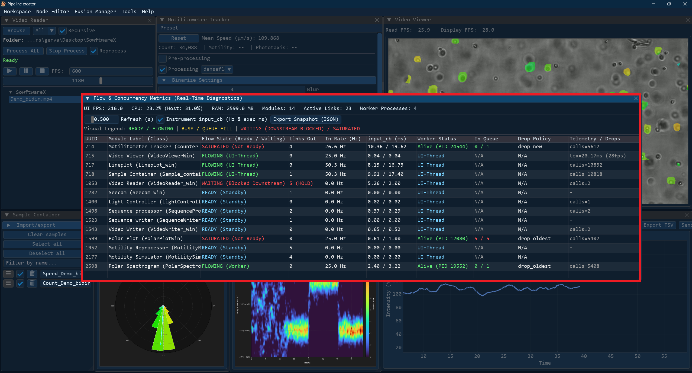
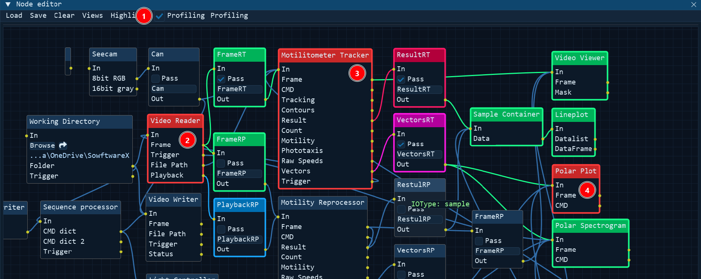
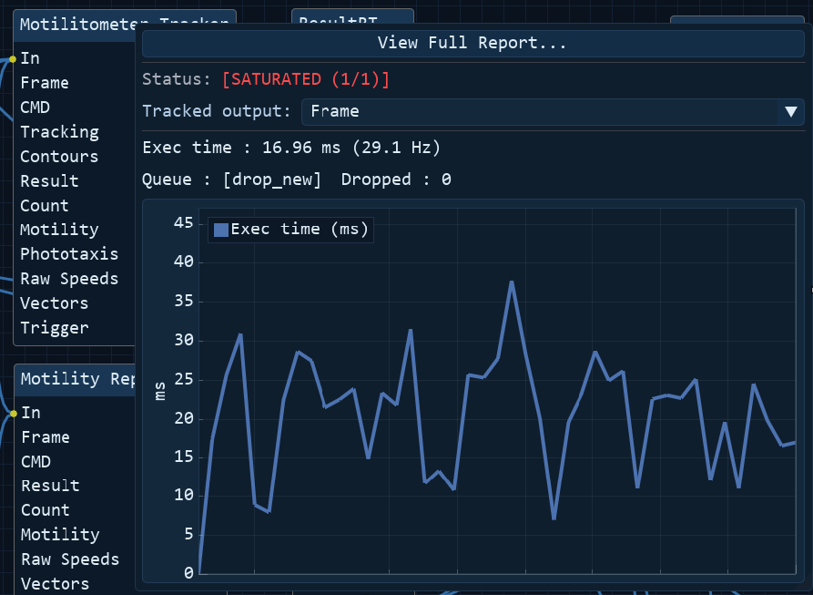
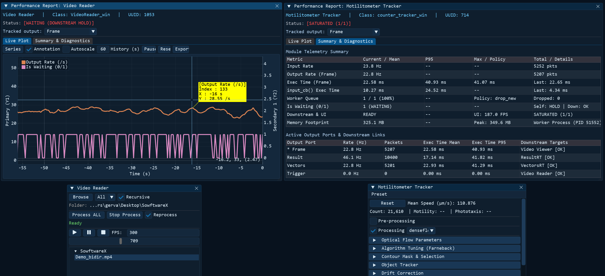
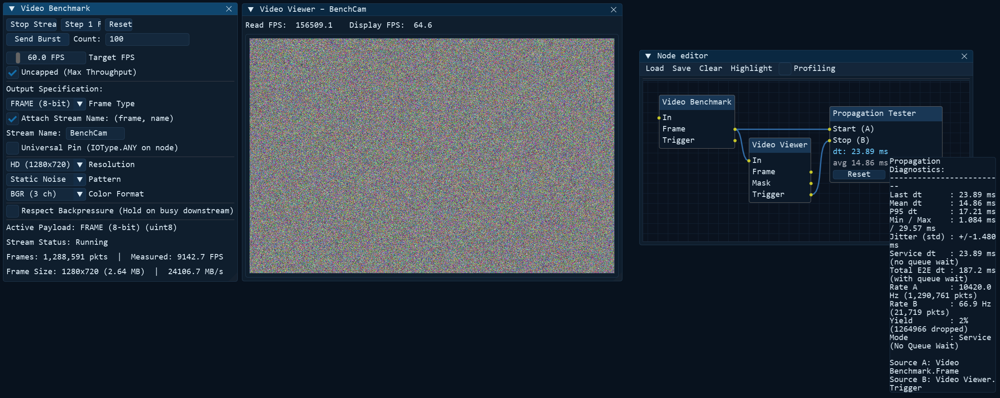

# <u>Flow Metrics & Pipeline Benchmarking</u>

As pipeline topologies grow in complexity, diagnosing latency spikes, camera frame drops, or throughput degradation across multiple processes can become challenging. Pipeline Creator integrates dedicated diagnostics and benchmark tools designed to provide complete observability over data transmission, queue occupancy, and execution performance without degrading user interface responsiveness.

---

## <u>Flow Metrics Viewer</u>

The **Flow Metrics Viewer** serves as an application-wide diagnostics and process manager. It provides a live, centralized overview of all instantiated modules, background worker processes, and connection links.

By continuously observing message frequencies, callback execution latencies, and queue fill levels across the graph, it allows operators to immediately pinpoint processing bottlenecks. Because telemetry relies on non-intrusive timestamp sampling and shared memory counters, the viewer runs with minimal footprint and can remain open during live production or data acquisition without degrading framerates.

Open it from the top menu bar via **Tools → Flow Metrics**.

### Global Resource Banner

The top bar displays live aggregate performance counters across the entire application:

- **UI FPS**: Rendering framerate of the DearPyGui interface.
- **CPU %**: Total normalized CPU consumption (0–100% across all CPU cores) combining the main UI process and all worker processes.
- **RAM MB**: Total Resident Set Size (RSS) memory footprint in megabytes.
- **Modules**: Total number of active module instances instantiated on the canvas.
- **Active Links**: Total number of active wire connections between modules.
- **Worker Processes**: Number of background worker processes spawned and running.

---

### Controls & Options

- **Refresh (s)**: Adjust the telemetry polling interval between `0.1s` and `2.0s` (default: `0.5s`).
- **Instrument input_cb**: Checkbox to toggle lightweight timing probes on module callbacks. When enabled, it calculates incoming message frequencies (Hz) and execution duration (ms).
- **Export Snapshot (JSON)**: Saves a complete timestamped diagnostic report containing all module metrics, queue fill levels, and system stats to `logs/benchmarks/flow_metrics_<timestamp>.json`.

---

### Flow States & Visual Legend

Each row in the table is color-coded to immediately identify pipeline health and bottlenecks:

| State | Color | Meaning |
|---|---|---|
| **READY / FLOWING** | Green | Normal operation. The module is responsive, queues are healthy, and downstream consumers accept data. |
| **BUSY / QUEUE FILL** | Yellow | High load. The worker is computing or the input queue is more than 50% full. |
| **WAITING / SATURATED** | Red | Congestion / Bottleneck. A downstream consumer is blocking (`HOLD`), the input queue is full, or the worker has stopped. |
| **UI-THREAD / STANDBY** | Cyan | Lightweight module executing directly on the main UI thread without a background worker process. |

---

### Metrics Table Columns

| Column | Description |
|---|---|
| **UUID** | Shortened unique identifier of the module instance. |
| **Module Label (Class)** | User-defined label of the node followed by its underlying Python class name. |
| **Flow State** | Live status indicator (`READY`, `BUSY`, `WAITING (HOLD)`, `UI-THREAD`, `IDLE`). |
| **Links Out** | Number of outgoing connections. Displays a `(HOLD)` warning if downstream backpressure is blocking transmission. |
| **In Rate (Hz)** | Instantaneous incoming message rate calculated over a 2.5-second sliding window. |
| **input_cb (ms)** | Callback execution latency, showing the mean and 95th percentile (`mean / P95 ms`). |
| **Worker Status** | Process state and operating system PID (`Running (PID: ...)`, `Stopped`, or `UI-Thread`). |
| **In Queue** | Current backlog of items versus total capacity (`current / max`, e.g. `2 / 10`). |
| **Drop Policy** | Active queue overflow policy: `drop_new` (discard incoming), `drop_oldest` (latest wins), or `block`. |
| **Telemetry / Drops** | Cumulative call count, dropped frame counter, and custom module telemetry metrics. |

---

## <u>Node Editor In-Canvas Profiling</u>

In addition to the global Flow Metrics Viewer, the **Node Editor** includes an embedded profiling tool that provides immediate visual feedback directly on the canvas. When enabled, it reveals live pipeline activity, pulses active data streams, and highlights where queues or connections are saturated.

Activate it in the Node Editor menu bar by checking the **Profiling** checkbox (1).

### Real-Time Flow & Heartbeat
Once profiling mode is active, active nodes and connection wires pulse dynamically as data packets travel through the graph. This visual "heartbeat" makes it easy to distinguish between flowing pipelines, idle branches, and congested links at a glance. Blocked/Saturated modules (1-4) are colored in red. 

### Node Quick Telemetry Popup
Right-clicking any node while in profiling mode displays a real-time status summary for that specific module:

This quick popup shows:

- **Instant Processing Times**: Mean execution time of `input_cb` and processing frequency (Hz).
- **Targeted Output Inspection**: Observe latency and throughput metrics for individual output terminals or across the module as a whole.
- **Queue Status**: Instantaneous view of input queue fill levels and backpressure state.

### Full Telemetry Reports

Clicking **View Full Report** from the right-click popup opens a dedicated, floating performance report window for that node:

- **Interactive Multi-Axis Live Plot**: Select which metrics to visualize simultaneously (rates in Hz, callback turnaround in ms, memory RSS/peak MB, queue fill percentage) across primary and secondary right Y-axes with interactive pan, wheel zoom, and cursor annotations.
- **Detailed Summary Table**: Access comprehensive percentiles (mean, P95, max), execution latencies, invocation counts, memory allocation, and queue drop counts.
- **Per-Port Routing Table**: Inspect individual output port rates, turnaround times, and downstream receiver availability status (`OK` vs `HOLD`).
- **Telemetry Export**: Export the live telemetry session to CSV or JSON for post-run analysis.

!!! tip "Simultaneous Multi-Module Diagnostics & Stress Testing"
    You can open multiple telemetry report windows simultaneously across different nodes in your pipeline. By comparing live metrics side-by-side during runtime, you can observe exact inter-module interactions and precisely determine where, when, and how bottlenecks form.
    
    This capability is particularly valuable when performing benchmarks or stress-testing custom nodes under sustained high-frequency loads. For dedicated stress test and synthetic workload generators, see [Module Stress Testing & Benchmark Suite](#module-stress-testing-benchmark-suite).

---

## <u>In-Flow Propagation Tester (Speedometer Node)</u>

For an ultra-lightweight way to monitor pipeline speed and latency without opening separate report windows, you can insert **Propagation Tester** nodes directly onto the canvas. 

The Propagation Tester acts as an inline "speedometer gauge" that connects between any two points in the graph to measure the precise transit duration (Delta-t) of data packets across a sub-graph, pipeline hop, or module chain.

Add it via the canvas right-click context menu: **Right Click Canvas → Add Node → Propagation Tester**.

### How It Works

The node provides two specialized input pins:

- **Start (A)**: Connect to the output of the upstream sender (e.g. Module A). The timestamp is captured immediately as data leaves Module A.
- **Stop (B)**: Connect to the output of the downstream receiver or final processing node (e.g. Module B). The timestamp is captured upon completion, computing the elapsed propagation duration (Delta-t).

Because both pins act as transparent observation probes with zero backpressure (`is_ready()` permanently `True`), the Propagation Tester does not alter or delay the measured pipeline.

### Readouts & Metrics

The node body updates live directly on the canvas:

- **Instantaneous & Average Delta-t**: Digital readout formatted with microsecond precision (`mean`, `last`, `P95`, `min`, `max`, `std`).
- **Inflow & Outflow Rates**: Instantaneous frequencies (Hz) measured at Pin A and Pin B.
- **Packet Counters & Drops**: Monitored count of matched pulses, unmatched events, and dropped frames.
- **Detailed Tooltip**: Hovering over the node displays a complete latency breakdown and variance statistics.
- **Reset Button**: Clears the sliding history window and counter registers at any moment during acquisition.

---

## <u>Module Stress Testing & Benchmark Suite</u>

To help developers stress-test module stability, queue overflow behavior, and throughput boundaries, and to help users benchmark their hardware capabilities when running demanding pipelines, Pipeline Creator includes a dedicated suite of synthetic **Benchmark modules** located in `modules/benchmark/`.

These tools allow you to generate variable, high-rate streams across all major `IOTypes`, as well as mock processing sinks capable of executing parameterized CPU or GPU workloads.

### Dual-Role Testing Architecture

The benchmark tools serve two primary operational roles:

1. **Producer Testing (Stress-testing your module's inputs)**:

   Wire a benchmark producer directly into your custom module. You can configure payload sizes (e.g. 720p/1080p/4K frames, sample lengths from 16 to 100,000+ points, vector densities up to 65,536 elements) and stream emission rates (controlled 1–1000 Hz or uncapped CPU throughput).
   
   This allows you to:
   - Identify the exact saturation point and maximum throughput of your module.
   - Verify that your queue `drop_policy` (`drop_oldest`, `drop_new`, `block`) triggers correctly under sustained overload.
   - Confirm that your module safely handles diverse data formats (e.g. 8-bit, 12-bit HDR, 16-bit HDR, masks, and accessory tuples).

2. **Sink Testing (Stress-testing your module's outputs)**:

   Wire your custom module's outputs into a benchmark processor sink. The mock processor consumes incoming data while applying configurable processing workloads—from zero-compute pass-through (measuring pure IPC serialization latency) up to intensive CPU matrix burns or GPU acceleration.
   
   This allows you to:

   - Observe how downstream backpressure (`HOLD`) impacts your upstream worker processes.
   - Measure at what processing delay downstream queues begin to fill and drop items.

3. **End-to-End Hardware Benchmarking**:

   Connect benchmark producers and processor sinks together in various topologies (linear chains, fan-out branches, circular feedback loops) to evaluate your machine's CPU core scaling, OpenCL GPU compute, RAM bandwidth, and shared memory IPC limits.

---

### Available Benchmark Modules

The suite comprises specialized generator and consumer modules:

| Module | Role | Supported IOTypes | Key Capabilities |
|---|---|---|---|
| **Video Benchmark** (`video_benchmark_win.py`) | Producer | `FRAME`, `FRAME12`, `FRAME16`, `MASK`, `FRAME_MASK_PAIR` | Zero-allocation synthetic camera generator. Configurable resolutions (up to 4K), 8/12/16-bit depths, color spaces, noise patterns, and rates up to 500+ FPS or uncapped. |
| **Image Processor Benchmark** (`image_processor_benchmark_win.py`) | Processor / Sink | `FRAME`, `FRAME12`, `FRAME16`, `MASK`, `FRAME_MASK_PAIR`, `ANY` | Multiprocessing worker stress-tester. Features configurable algorithms (Pass-Through, Invert, Blur, Sobel, Canny, Bilateral, CPU matrix burn) with CPU vs OpenCL GPU hardware acceleration. |
| **Sample Benchmark** (`sample_benchmark_win.py`) | Producer | `SAMPLE`, `NUMBER`, `DATALIST` | High-frequency numerical sample generator. Pre-rendered waveforms (Sine, Chirp, Square, Noise, Random Walk), 16 to 100,000+ points, controlled 1–1000 Hz or uncapped. |
| **Sample Processor Benchmark** (`sample_processor_benchmark_win.py`) | Processor / Sink | `SAMPLE`, `NUMBER`, `DATALIST`, `ANY` | Multiprocessing numerical processing sink. Configurable simulated compute delay, queue capacity, and mathematical transformations. |
| **Vector Benchmark** (`vector_benchmark_win.py`) | Producer | `VECTORS`, `SAMPLE` | High-density vector field generator. Emits angular distributions (Spotlight, Bimodal, Pendulum, Vortex) with 16 to 65,536+ vectors per frame, burst mode, and batch mode. |
| **CMD Benchmark** (`cmd_benchmark_win.py`) | Producer / Tester | `CMD_DICT`, `TRIGGER`, `NUMBER`, `TEXT` | Command and control packet generator. Tests latency, response turnaround, and command sequencing. |
| **Hardware Simulator** (`hardware_simulator_win.py`) | Simulator / Sink | `TRIGGER`, `TEXT`, `ANY` | Simulates physical hardware device delays, communication timeouts, and intermittent failures for robust error-handling validation. |
