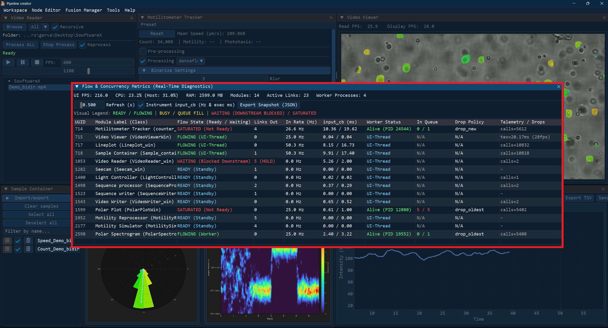
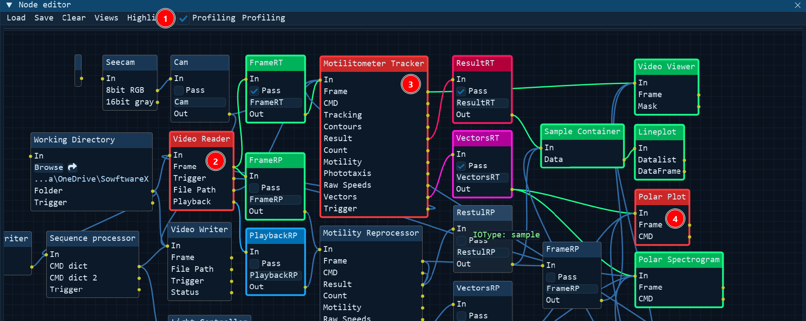
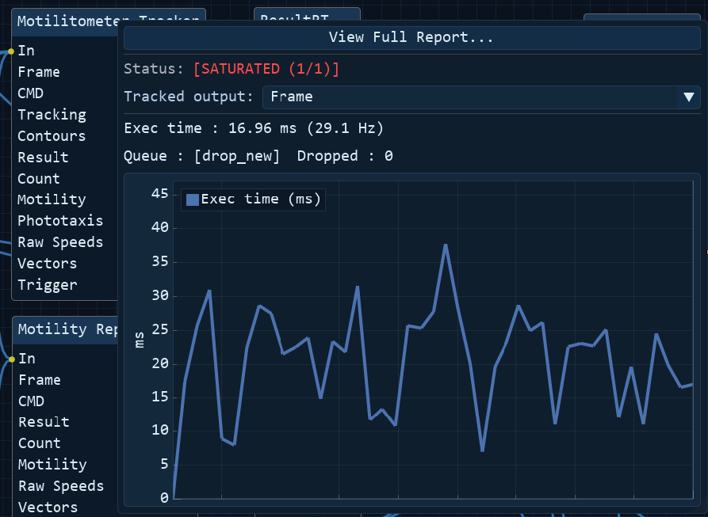
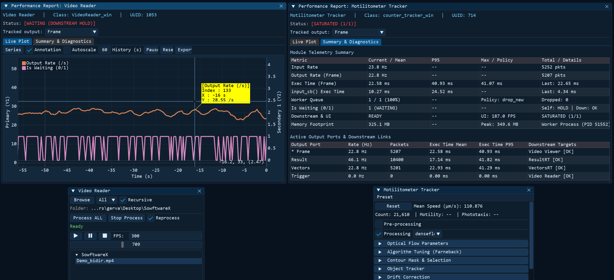
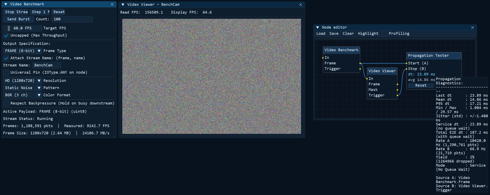

# <u>Flow Metrics & Pipeline Benchmarking</u>

As pipeline topologies grow in complexity, diagnosing latency spikes, camera frame drops, or throughput degradation across multiple processes can become challenging. Pipeline Creator integrates dedicated diagnostics and benchmark tools designed to provide complete observability over data transmission, queue occupancy, and execution performance without degrading user interface responsiveness.

---

## <u>Flow Metrics Viewer</u>

The **Flow Metrics Viewer** serves as an application-wide diagnostics and process manager. It provides a live, centralized overview of all instantiated modules, background worker processes, and connection links.

By continuously observing message frequencies, callback execution latencies, and queue fill levels across the graph, it allows operators to immediately pinpoint processing bottlenecks. Because telemetry relies on non-intrusive timestamp sampling and shared memory counters, the viewer runs with minimal footprint and can remain open during live production or data acquisition without degrading framerates.

Open it from the top menu bar via **Tools → Flow Metrics**.



### Global Resource Banner

The top bar displays live aggregate performance counters across the entire application:

- **UI FPS**: Rendering framerate of the DearPyGui interface.
- **CPU %**: Total normalized CPU consumption (0–100% across all CPU cores) combining the main UI process and all worker processes.
- **RAM MB**: Total Resident Set Size (RSS) memory footprint in megabytes.
- **Modules**: Total number of active module instances instantiated on the canvas.
- **Active Links**: Total number of active wire connections between modules.
- **Worker Processes**: Number of background worker processes spawned and running.

---

### Controls & Options

- **Refresh (s)**: Adjust the telemetry polling interval between `0.1s` and `2.0s` (default: `0.5s`).
- **Instrument input_cb**: Checkbox to toggle lightweight timing probes on module callbacks. When enabled, it calculates incoming message frequencies (Hz) and execution duration (ms).
- **Export Snapshot (JSON)**: Saves a complete timestamped diagnostic report containing all module metrics, queue fill levels, and system stats to `logs/benchmarks/flow_metrics_<timestamp>.json`.

---

### Flow States & Visual Legend

Each row in the table is color-coded to immediately identify pipeline health and bottlenecks:

| State | Color | Meaning |
|---|---|---|
| **READY / FLOWING** | Green | Normal operation. The module is responsive, queues are healthy, and downstream consumers accept data. |
| **BUSY / QUEUE FILL** | Yellow | High load. The worker is computing or the input queue is more than 50% full. |
| **WAITING / SATURATED** | Red | Congestion / Bottleneck. A downstream consumer is blocking (`HOLD`), the input queue is full, or the worker has stopped. |
| **UI-THREAD / STANDBY** | Cyan | Lightweight module executing directly on the main UI thread without a background worker process. |

---

### Metrics Table Columns

| Column | Description |
|---|---|
| **UUID** | Shortened unique identifier of the module instance. |
| **Module Label (Class)** | User-defined label of the node followed by its underlying Python class name. |
| **Flow State** | Live status indicator (`READY`, `BUSY`, `WAITING (HOLD)`, `UI-THREAD`, `IDLE`). |
| **Links Out** | Number of outgoing connections. Displays a `(HOLD)` warning if downstream backpressure is blocking transmission. |
| **In Rate (Hz)** | Instantaneous incoming message rate calculated over a 2.5-second sliding window. |
| **input_cb (ms)** | Callback execution latency, showing the mean and 95th percentile (`mean / P95 ms`). |
| **Worker Status** | Process state and operating system PID (`Running (PID: ...)`, `Stopped`, or `UI-Thread`). |
| **In Queue** | Current backlog of items versus total capacity (`current / max`, e.g. `2 / 10`). |
| **Drop Policy** | Active queue overflow policy: `drop_new` (discard incoming), `drop_oldest` (latest wins), or `block`. |
| **Telemetry / Drops** | Cumulative call count, dropped frame counter, and custom module telemetry metrics. |

---

## <u>Node Editor In-Canvas Profiling</u>

In addition to the global Flow Metrics Viewer, the **Node Editor** includes an embedded profiling tool that provides immediate visual feedback directly on the canvas. When enabled, it reveals live pipeline activity, pulses active data streams, and highlights where queues or connections are saturated.

Activate it in the Node Editor menu bar by checking the **Profiling** checkbox (1).


### Real-Time Flow & Heartbeat
Once profiling mode is active, active nodes and connection wires pulse dynamically as data packets travel through the graph. This visual "heartbeat" makes it easy to distinguish between flowing pipelines, idle branches, and congested links at a glance. Blocked/Saturated modules (1-4) are colored in red. 

### Node Quick Telemetry Popup
Right-clicking any node while in profiling mode displays a real-time status summary for that specific module:



This quick popup shows:

- **Instant Processing Times**: Mean execution time of `input_cb` and processing frequency (Hz).
- **Targeted Output Inspection**: Observe latency and throughput metrics for individual output terminals or across the module as a whole.
- **Queue Status**: Instantaneous view of input queue fill levels and backpressure state.

### Full Telemetry Reports

Clicking **View Full Report** from the right-click popup opens a dedicated, floating performance report window for that node:



- **Interactive Multi-Axis Live Plot**: Select which metrics to visualize simultaneously (rates in Hz, callback turnaround in ms, memory RSS/peak MB, queue fill percentage) across primary and secondary right Y-axes with interactive pan, wheel zoom, and cursor annotations.
- **Detailed Summary Table**: Access comprehensive percentiles (mean, P95, max), execution latencies, invocation counts, memory allocation, and queue drop counts.
- **Per-Port Routing Table**: Inspect individual output port rates, turnaround times, and downstream receiver availability status (`OK` vs `HOLD`).
- **Telemetry Export**: Export the live telemetry session to CSV or JSON for post-run analysis.

!!! tip "Simultaneous Multi-Module Diagnostics & Stress Testing"
    You can open multiple telemetry report windows simultaneously across different nodes in your pipeline. By comparing live metrics side-by-side during runtime, you can observe exact inter-module interactions and precisely determine where, when, and how bottlenecks form.
    
    This capability is particularly valuable when performing benchmarks or stress-testing custom nodes under sustained high-frequency loads. For dedicated stress test and synthetic workload generators, see [Module Stress Testing & Benchmark Suite](#module-stress-testing-benchmark-suite).

---

## <u>In-Flow Propagation Tester (Speedometer Node)</u>

For an ultra-lightweight way to monitor pipeline speed and latency without opening separate report windows, you can insert **Propagation Tester** nodes directly onto the canvas. 

The Propagation Tester acts as an inline "speedometer gauge" that connects between any two points in the graph to measure the precise transit duration (Delta-t) of data packets across a sub-graph, pipeline hop, or module chain.

Add it via the canvas right-click context menu: **Right Click Canvas → Add Node → Propagation Tester**.



### How It Works

The node provides two specialized input pins:

- **Start (A)**: Connect to the output of the upstream sender (e.g. Module A). The timestamp is captured immediately as data leaves Module A.
- **Stop (B)**: Connect to the output of the downstream receiver or final processing node (e.g. Module B). The timestamp is captured upon completion, computing the elapsed propagation duration (Delta-t).

Because both pins act as transparent observation probes with zero backpressure (`is_ready()` permanently `True`), the Propagation Tester does not alter or delay the measured pipeline.

### Readouts & Metrics

The node body updates live directly on the canvas:

- **Instantaneous & Average Delta-t**: Digital readout formatted with microsecond precision (`mean`, `last`, `P95`, `min`, `max`, `std`).
- **Inflow & Outflow Rates**: Instantaneous frequencies (Hz) measured at Pin A and Pin B.
- **Packet Counters & Drops**: Monitored count of matched pulses, unmatched events, and dropped frames.
- **Detailed Tooltip**: Hovering over the node displays a complete latency breakdown and variance statistics.
- **Reset Button**: Clears the sliding history window and counter registers at any moment during acquisition.

---

## <u>Module Stress Testing & Benchmark Suite</u>

To help developers stress-test module stability, queue overflow behavior, and throughput boundaries, and to help users benchmark their hardware capabilities when running demanding pipelines, Pipeline Creator includes a dedicated suite of synthetic **Benchmark modules** located in `modules/benchmark/`.

These tools allow you to generate variable, high-rate streams across all major `IOTypes`, as well as mock processing sinks capable of executing parameterized CPU or GPU workloads.

### Dual-Role Testing Architecture

The benchmark tools serve two primary operational roles:

1. **Producer Testing (Stress-testing your module's inputs)**:

   Wire a benchmark producer directly into your custom module. You can configure payload sizes (e.g. 720p/1080p/4K frames, sample lengths from 16 to 100,000+ points, vector densities up to 65,536 elements) and stream emission rates (controlled 1–1000 Hz or uncapped CPU throughput).
   
   This allows you to:
   - Identify the exact saturation point and maximum throughput of your module.
   - Verify that your queue `drop_policy` (`drop_oldest`, `drop_new`, `block`) triggers correctly under sustained overload.
   - Confirm that your module safely handles diverse data formats (e.g. 8-bit, 12-bit HDR, 16-bit HDR, masks, and accessory tuples).

2. **Sink Testing (Stress-testing your module's outputs)**:

   Wire your custom module's outputs into a benchmark processor sink. The mock processor consumes incoming data while applying configurable processing workloads—from zero-compute pass-through (measuring pure IPC serialization latency) up to intensive CPU matrix burns or GPU acceleration.
   
   This allows you to:

   - Observe how downstream backpressure (`HOLD`) impacts your upstream worker processes.
   - Measure at what processing delay downstream queues begin to fill and drop items.

3. **End-to-End Hardware Benchmarking**:

   Connect benchmark producers and processor sinks together in various topologies (linear chains, fan-out branches, circular feedback loops) to evaluate your machine's CPU core scaling, OpenCL GPU compute, RAM bandwidth, and shared memory IPC limits.

---

### Available Benchmark Modules

The suite comprises specialized generator and consumer modules:

| Module | Role | Supported IOTypes | Key Capabilities |
|---|---|---|---|
| **Video Benchmark** (`video_benchmark_win.py`) | Producer | `FRAME`, `FRAME12`, `FRAME16`, `MASK`, `FRAME_MASK_PAIR` | Zero-allocation synthetic camera generator. Configurable resolutions (up to 4K), 8/12/16-bit depths, color spaces, noise patterns, and rates up to 500+ FPS or uncapped. |
| **Image Processor Benchmark** (`image_processor_benchmark_win.py`) | Processor / Sink | `FRAME`, `FRAME12`, `FRAME16`, `MASK`, `FRAME_MASK_PAIR`, `ANY` | Multiprocessing worker stress-tester. Features configurable algorithms (Pass-Through, Invert, Blur, Sobel, Canny, Bilateral, CPU matrix burn) with CPU vs OpenCL GPU hardware acceleration. |
| **Sample Benchmark** (`sample_benchmark_win.py`) | Producer | `SAMPLE`, `NUMBER`, `DATALIST` | High-frequency numerical sample generator. Pre-rendered waveforms (Sine, Chirp, Square, Noise, Random Walk), 16 to 100,000+ points, controlled 1–1000 Hz or uncapped. |
| **Sample Processor Benchmark** (`sample_processor_benchmark_win.py`) | Processor / Sink | `SAMPLE`, `NUMBER`, `DATALIST`, `ANY` | Multiprocessing numerical processing sink. Configurable simulated compute delay, queue capacity, and mathematical transformations. |
| **Vector Benchmark** (`vector_benchmark_win.py`) | Producer | `VECTORS`, `SAMPLE` | High-density vector field generator. Emits angular distributions (Spotlight, Bimodal, Pendulum, Vortex) with 16 to 65,536+ vectors per frame, burst mode, and batch mode. |
| **CMD Benchmark** (`cmd_benchmark_win.py`) | Producer / Tester | `CMD_DICT`, `TRIGGER`, `NUMBER`, `TEXT` | Command and control packet generator. Tests latency, response turnaround, and command sequencing. |
| **Hardware Simulator** (`hardware_simulator_win.py`) | Simulator / Sink | `TRIGGER`, `TEXT`, `ANY` | Simulates physical hardware device delays, communication timeouts, and intermittent failures for robust error-handling validation. |
| **Perf Pulse Source** (`perf_pulse_source_win.py`) | Micro-Benchmark Source | `ANY`, `TRIGGER`, `CMD_DICT` | Nanosecond-stamped packet and NumPy array emitter (`token`, `numpy_1kb` to `numpy_4mb`, `numpy_1080p_rgb`). Supports bursts, paced/uncapped streams, `Stop` interruption, and AutomationManager profiler control. |
| **Perf Relay Node** (`perf_relay_win.py`) | Relay / Terminal Sink | `ANY`, `TRIGGER`, `SAMPLE`, `FRAME`, `CMD_DICT` | Zero-compute pass-through relay and terminal sink that measures single-hop (`link_hop_ns`) and end-to-end DAG (`e2e_dag_ns`) latency with configurable UI update cadence (`ui_update_hz`). |
| **Perf Worker Node** (`perf_worker_win.py`) | IPC Worker Wrapper | `ANY`, `SAMPLE`, `FRAME`, `CMD_DICT` | Dedicated `ProcessingBase` wrapper (`PerfPassWorker` with `ShmPool` or `PerfPassNoShmWorker` with `use_shared_memory=False`) that breaks down main-thread encoding, queue transit, worker compute, and IPC return latency. |

### Interactive vs Automated Mode for Perf Nodes

When wiring `PerfPulseSource_win`, `PerfRelayNode_win`, and `PerfWorkerNode_win` manually on the canvas:

- **Manual Testing (`framework_profiler.enabled == False`)**: Clicking **Burst** or **Stream** automatically refreshes node readouts (`Emitted`, `Recv`, `Last hop`, `Done | Drop`) at **15 Hz** and forces a final exact counter sync when the run ends. Clicking **Stop** triggers an internal `threading.Event` to halt an ongoing burst or stream immediately.
- **Automated Profiling (`framework_profiler.enabled == True`)**: By default (`ui_update_hz = 0.0`), Perf nodes skip widget text updates to isolate pure framework overhead; calling `set_cluster_ui_update_hz(30.0)` enables realistic 30 Hz live widget updates during benchmark sweeps.

---

## <u>Automated Framework Benchmark & Stress-Test Suite</u>

Beyond live interactive inspection, Pipeline Creator provides an automated, reproducible benchmark and progressive stress-testing suite in `tools/run_benchmark.py`. It measures nanosecond framework overhead, isolates multiprocessing serialization costs (`ShmPool` shared memory vs pure `pickle`), compares headless and GUI execution modes, and identifies practical hardware breaking points on your workstation.

### Quick Start & CLI Commands

By default, running `tools/run_benchmark.py` executes the **complete end-to-end pipeline** automatically in a single command:

1. Regenerates all pipeline layouts and AutomationManager scripts in `benchmark/generated/`.
2. Runs the headless matrix, 3-mode comparison, and progressive stress sweeps.
3. Synthesizes `benchmark/benchmark_report.{json,csv,md}` and `benchmark/summary.md`.
4. Generates all figures (`PNG` + `PDF`) in `benchmark/figures/`, plus `benchmark/interactive_report.html` and `benchmark/benchmark_analysis.ipynb`.

```bash
# From source
python tools/run_benchmark.py

# Directly from a compiled build (writes outputs to benchmark/ next to the .exe)
PipelineCreator.exe --run-benchmark

# From source, targeting a compiled executable
python tools/run_benchmark.py --exe path/to/main.dist/PipelineCreator.exe
```

!!! note "Compiled Executable Requirements"
    When running `PipelineCreator.exe --run-benchmark` (or `PipelineCreator.exe -m tools.run_benchmark`), ensure the executable was built with `MAIN_PIPELINE = None` in `make_executable.py` so `modules/benchmark/` is included in `main.dist/modules/`. All selective flags below work identically with `--run-benchmark`.

#### Selective Benchmark Flags (`tools/run_benchmark.py` / `--run-benchmark`)

| Flag | Description |
|---|---|
| `--skip-matrix` | Skip the headless scaling matrix (still builds all outputs at the end). |
| `--skip-headless-cmp` | Skip the headless pass of the 3-mode comparison scenarios. |
| `--skip-gui` | Skip the Passive GUI comparison pass (`live_ui_updates=False`). |
| `--skip-gui-live` | Skip the Realistic 30 Hz Live-UI GUI comparison pass. |
| `--skip-stress` | Skip the progressive stress-test breaking-point sweeps. |
| `--stress-only` | Run only the progressive stress sweeps (Headless + Live-UI) and rebuild all combined figures and reports. |
| `--rebuild-only` | Regenerate `benchmark/generated/` pipelines & scripts, `summary.md`, `benchmark_report.*`, `interactive_report.html`, `benchmark_analysis.ipynb`, and `benchmark/figures/` (PNG & PDF) from existing JSON/CSV results without re-running benchmarks. |
| `--exe PATH` | Path to a compiled `PipelineCreator.exe` (or its `main.dist` folder) to benchmark instead of `main.py` from source. Automatically defaults to itself when invoked via `PipelineCreator.exe --run-benchmark`. |

Running an individual benchmark script directly (e.g., `python main.py --headless --script benchmark/generated/scripts/headless_matrix_script.json`) also triggers figure and interactive report generation automatically at export time unless orchestrated by `tools/run_benchmark.py`.

#### Optional Standalone Sub-Tools

If you only want to invoke the low-level figure or report builders on a custom CSV/JSON file outside `tools/run_benchmark.py --rebuild-only`:

```bash
# Regenerate matplotlib figures (PNG and/or PDF)
python tools/plot_benchmark_figures.py --csv benchmark/benchmark_report.csv --out-dir benchmark/figures --formats png,pdf

# Regenerate the interactive Plotly HTML dashboard and Jupyter Notebook
python tools/generate_user_reports.py --json benchmark/benchmark_report.json --csv benchmark/benchmark_report.csv --out-html benchmark/interactive_report.html --out-ipynb benchmark/benchmark_analysis.ipynb
```

---

### Core Instrumentation (`FrameworkProfiler`)

All automated scenarios are instrumented by the global `framework_profiler` singleton in `core/framework_profiler.py`:

- **Nanosecond Precision**: Uses `time.perf_counter_ns()` across dispatch, link hops, DAG terminal arrival, and `ProcessingBase` child IPC transitions.
- **Exact Percentile Statistics**: `summarize_samples_ns()` computes `count`, `min`, `mean`, `std`, `p50` (median), `p95`, `p99`, and `max` in microseconds (`us`) for every recorded metric.
- **Process-Tree Resource Telemetry**: Polls parent and child process RSS memory (`rss_peak_mb`), normalized CPU utilization (`cpu_mean_pct`), thread count, and child process count via `psutil`.
- **Uncapped Frame-Rate Probing**: Under `--script` automation, `main.py` disables VSync (`use_vsync = False`), requests 1 ms Windows timer resolution (`winmm.timeBeginPeriod(1)`), and records actual viewport render times (`notify_frame_rendered`, `pump_gui_frame_if_needed`, and `_run_uncapped_fps_probe`) to measure true UI headroom.

!!! note "Power Mode & Display Swapchain Caps"
    Even with VSync disabled in DearPyGui, laptop battery power profiles (e.g., Windows Dynamic Refresh Rate or hybrid GPU battery savers) may clamp DXGI swapchain presentation to ~48 FPS. Run GUI benchmarks on AC power for unthrottled maximum FPS measurements.

---

### What the Benchmark Matrix Tests

#### 1. Intra-Process Routing & Topology Scaling (Headless)
- **Calibration (`calibration_profiler_self_overhead`)**: Quantifies the measurement noise floor of `time.perf_counter_ns()` and `record_hop`.
- **Zero-Copy Reference vs NumPy Transfers (`hop_1to1_*`)**: Compares Python token objects against `1 KB` and `1 MB` NumPy arrays passed across module links (`link_hop_ns`, `e2e_dag_ns`).
- **Conditional & Bus Routing (`routing_gate`, `routing_linkbus`)**: Isolates per-packet overhead of `Gate` flow control and `LinkOut -> LinkBus -> LinkIn` publish/subscribe routing.
- **Topologies**: Evaluates linear chains (`chain_d2` through `chain_d40`), 1-to-K broadcast fan-out (`fanout_k1` through `fanout_k64`), and multi-layer dense meshes (`mesh_2x4`, `mesh_4x4`, `mesh_4x8`).

#### 2. Multiprocess IPC Breakdown (`ShmPool` vs Pure Pickle)
Using `PerfWorkerNode_win` (`PerfPassWorker` vs `PerfPassNoShmWorker`), each round-trip is decomposed into 4 stages:
- `proc_main_encode_ns`: Main-process serialization / shared-memory write before queue push.
- `proc_ipc_in_ns`: OS pipe/queue transit into the child worker process.
- `proc_worker_compute_ns`: Child `_process_data` execution time.
- `proc_ipc_out_ns`: Return queue transit back to the parent polling thread.
- `proc_total_roundtrip_ns` & `proc_ipc_overhead_ns`: Full end-to-end turnaround and pure IPC overhead excluding compute.

The suite directly contrasts `ShmPool` shared-memory transport against pure Python `pickle` (`use_shared_memory=False`) across `token`, `1 KB`, `64 KB`, `256 KB`, `1 MB`, and `4 MB` payloads, then scales parallel worker processes (`workers_parallel_p1` through `p16`) on realistic **1080p RGB frames (`1920x1080x3 uint8`, 6.22 MB)**.

#### 3. Three-Mode Execution Comparison (`cmp_*`)
Selected representative workloads (`cmp_hop_1to1_burst`, `cmp_hop_1to1_stream_uncapped`, `cmp_chain_d20_burst`, `cmp_fanout_k32_burst`, `cmp_mesh_4x8_burst`, `cmp_proc_shm_1mb`, `cmp_workers_p4_1080p`) are run side-by-side across three modes:

| Mode | Renderer / Viewport | Widget Updates | Purpose |
|---|---|---|---|
| `headless` | Disabled (`core/headless_runner.py`) | Skipped | Pure Python + IPC data-plane ceiling with zero GPU contention. |
| `gui` | Full DearPyGui (`vsync=False`) | Passive (`ui_update_hz = 0.0`) | Isolates base DearPyGui viewport loop overhead. |
| `gui_live_ui` | Full DearPyGui (`vsync=False`) | Active (`ui_update_hz = 30.0`, windows visible) | Realistic interactive desktop conditions with live UI telemetry updates. |

#### 4. Progressive Stress Suite & Breaking-Point Analysis (`stress_*`)
Designed as a hardware stress test when deploying Pipeline Creator on a target PC, the stress suite progressively increases workload complexity in both **`headless`** and **`gui_live_ui`** modes until real-time budgets or UI responsiveness saturate:

- **Serial Chain Depth**: `D = 2, 10, 20, 40, 80, 120, 160` (`stress_chain_d*`)
- **Parallel Fan-Out**: `K = 1, 4, 16, 32, 64, 128, 192` (`stress_fanout_k*`)
- **Dense Matrix Mesh**: `2x4, 3x4, 4x4, 4x6, 4x8, 5x6, 5x8` (`stress_mesh_*`)
- **Parallel 1080p RGB Workers**: `P = 1, 2, 4, 8, 12, 16` (and `P = 20` headless, `stress_workers_p*`)

Results are automatically classified by `FrameworkProfiler.compute_comfort_and_limits()`:
- **Real-Time Pipeline Budgets**: `Real-Time 60 Hz` (`<= 16.67 ms`), `Real-Time 30 Hz` (`<= 33.33 ms`), or `Over Real-Time Budget (>33.3 ms)`.
- **UI Interactive Comfort**: `Smooth` (`>= 45 FPS`), `Comfortable` (`25–45 FPS`), `Sluggish` (`12–25 FPS`), and `Critical / Breaking Point` (`< 12 FPS`).

---

### Generated Reports & Output Files (`benchmark/`)

All benchmark output artifacts (reports, figures, notebooks, raw JSON/CSV telemetry) are written to `benchmark/` and excluded by `.gitignore`, while the generated benchmark pipelines and automation scripts under `benchmark/generated/` remain tracked in Git:

| Output File | Description |
|---|---|
| `benchmark/interactive_report.html` | Self-contained interactive **Plotly** web dashboard featuring global KPI cards, a plain-language **Beginner Guide**, full embedded summary & PC-limit tables, interactive zoomable charts with `Mean -> p95` jitter bands, and a filterable/sortable full-scenario explorer (`Mode`, `Category`, `Comfort`, `Real-Time`, `Metric Scope`, text search, quick presets, and `us`/`ms`/`ns` unit selector). |
| `benchmark/summary.md` | Concise executive summary containing the **Global Summary**, **Practical PC Limits & UI Comfort**, and **GUI Impact** tables plus a quick interpretation guide. |
| `benchmark/benchmark_analysis.ipynb` | Pre-configured **Jupyter Notebook** (`nbformat` v4) loading `benchmark_report.json` / `.csv` into `pandas` and `matplotlib` for custom exploratory analysis. |
| `benchmark/benchmark_report.md` | Complete technical Markdown report with environment specs, summary tables, and full per-metric percentiles for every scenario. |
| `benchmark/benchmark_report.json` / `.csv` | Machine-readable JSON telemetry and flat CSV metric export (`matrix_headless.*`, `compare_*.*`, and `stress_*.*` intermediate passes are also preserved). |
| `benchmark/figures/` | Generated PNG/PDF figures (`fig1_framework_primitives`, `fig2_topology_scaling`, `fig3_ipc_worker_breakdown`, `fig4_headless_vs_gui`, `fig5_stress_limits_and_fps`). |

!!! tip "Reading Shaded Bands in Benchmark Plots"
    In `fig5_stress_limits_and_fps` and the Plotly charts inside `interactive_report.html`, the solid line traces the **Mean** latency across iterations, while the translucent **shaded band (`Mean -> p95`)** highlights how high occasional tail spikes reach (95th percentile jitter). Similarly, shaded `p50 -> p95` bands in topology/payload charts separate typical median speed from worst-case OS scheduling tails.
